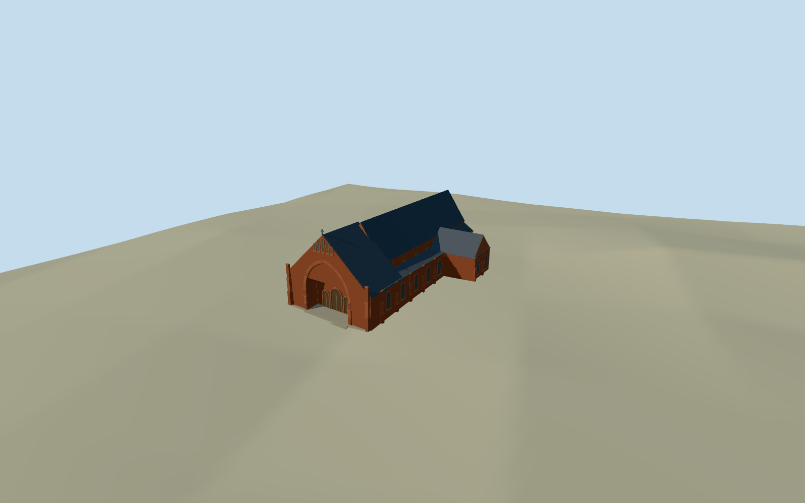

# Christ Church Cathedral, Grafton

Grafton’s salmon-brick Gothic cathedral with its recessed double west arch, lancet bays and steep grey slate roofs.

Authoring state: **review-in-qa.json**. Current completion evidence is in [qa.json](qa.json) and the [completion ledger](../../../../qualla-structures/batches/qualla-004.PROGRESS.md).

- [Christ Church Cathedral, Grafton](https://qualla.com/christ-church-cathedral-grafton/)

Draft exterior: approximate photographic proportions and simplified ornament. It is not a survey, photogrammetric reconstruction or approved current geographic replacement.

The published 1888 bird’s-eye view shows the first phase, main roof and lower aisle. Heritage NSW and the cathedral conservators record the 1937 continuation with eight nave bays, west double arch, baptistry, and repeating salmon brick.

Terrain sampling/contact, geographic alignment and site activation remain pending. Runtime LODs are produced by the registered after-import pipeline and require visual review.

Reference photos remain in the local Qualla corpus; only provenance, paths and hashes are retained here.

Build: `node content/worldgen/source/places/r6/r6s/christ_church_cathedral_grafton/models/generate-christ-church-cathedral-grafton.mjs`. Add `--check` to verify exact regeneration. 9210 triangles; 7 materials; no embedded photographs.
