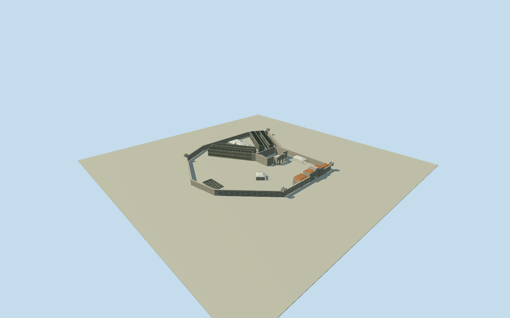

# Trial Bay Gaol

Whole surviving Trial Bay Gaol compound in exact native regional frame: enclosing granite wall/four original inferred open watchtowers, stepped central arched east gatehouse/barred windows/terracotta wings and connected quarters; two angled double-row roofless cell wings with exposed divisions and open aisles; roofless mess hall/three real arches/standing gables; native western kitchen/bakehouse/covered walk/north shelter/southeast small support roof; full low southern support archaeology. No whole-yard slab or restored ruined roofs. Nine cleared published2025creatorCC0 Qualla originals first/only imagery, no copied pixels. Heights/towercount-finefootprints/roof sections/cell census/exposed rubble/hiddenparts and exact hostground-contact are original estimates; preview/replaceFootprintfalse.

Authoring state: **review-in-qa.json**. Current completion evidence is in [qa.json](qa.json) and the [completion ledger](../../../../qualla-structures/batches/qualla-002.PROGRESS.md).

- [Trial Bay Gaol](https://qualla.com/trial-bay-gaol/)

Whole original native enclosing wall14controls and all integral native physical component/ruin/roof/void outlines. Fixed bboxanchor/heading0/+Xeast+Zsouth chosen before terrain/floor/sections/geometry. Museums grounds not filled or made building footprint; operator QID not adopted.

Whole original native prison wall/physical components/roofless voids, fixed nativebboxanchor/heading0/+Xeast+Zsouth preserved. Original400m129x12916641sample/one rawtile/SW12.0236m provider-relative datum frozen BEFORE every floor/section/geometry choice. Once-only eastgate originalfield sample givesfloor3.636m, fixed before geometry; no fit/flatten/reacquire/reframe/raise. Native MessHall7m height is explicitly estimated. Original creatorCC0 photo-based sections: wall4.65m/.72thick; roofless cells7.05m/.48walls/two storeys3.25floor/16simplifiedcellsperrow; messwall6.7/gable8.05/3realarchvoids; gateeave7.05/steppedpediment8.7/4.3mwide5mhigharch; connectedquarters4.5-5.45; kitchen3.15-4.35 and mapped coveredwalk/northshelter2.9-3.75; southeastsupport2.75-3.65; native southern supportoutline retained aslow.48m archaeology, not reconstructed hospital. Four original inferred2.7msquarewatchtowers at nativewallturns11/0/8/3 withopenparapets4.55-7m; precise footprint/count/height/alteration unsurveyed. Exterior window/cell/bar/gable/course/rubble census/currentfinish/hiddenroofsections and precise ground/archaeological contact are original bounded estimates. No whole-yard floor, restored roofs over ruined cells, vanished barracks, campground/breakwater/memorial/signart/sourcepixels. Original coastalfield negativeoutliers retained, not artificialgroundfit; geographicpreview/replaceFootprintfalse.

Nine exact published July2025 Aliceinthealice own/self-CC0 originals individually/contactsheet inspected and nativeSHA1 matched; unchanged published inventory policy passed. No supplementary images, questionable rights, source repairs/reclassification/guard changes or copied photographic textures. Complete native wall and physical component controls retained; operatorQID not adopted. Original inferred watchtowers/roof ridges/cell-wall/partitions and low archaeological form/census are bounded estimates; no survey or authoritative current reconstruction.

Original independent400m129x12916641sample/one rawtile field, fixed nativebboxanchor/heading0 and SW12.0236m provider-relative datum frozen before floor/sections/geometry. Once-only eastgatefloor3.636m remains fixed. Extreme coastalDEM negatives retained, not archaeology/bathymetry. No fit/flatten/reacquire/reframe/late raising; precise ground and ruin-level contact unverified. Geographic preview/replaceFootprintfalse; flat portableground and contextneighbors are review fixtures only.

Build: `node content/worldgen/source/places/r6/r6s/trial_bay_gaol/models/generate-trial-bay-gaol.mjs`. Add `--check` to verify exact regeneration. 57798 triangles; 4 materials; no embedded photographs.
