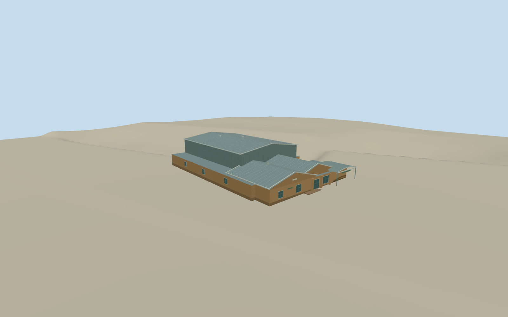

# Ballina Naval and Maritime Museum

Buff brick entrance gables, gray metal roofing, a curved entrance canopy and the taller corrugated raft hall at the Ballina Naval and Maritime Museum.

Authoring state: **review-in-qa.json**. Current completion evidence is in [qa.json](qa.json) and the [completion ledger](../../../../qualla-structures/batches/qualla-003.PROGRESS.md).

- [Ballina Naval & Maritime Museum](https://qualla.com/ballina-naval-maritime-museum/)

The museum represents July 2017. The visible low gables and tall corrugated hall follow the exact Qualla photo, and the mapped perimeter constrains the whole building. Roof sections and obscured elevations are estimated.

The original terrain field is preserved. Entrance and riverside paving, window counts and service openings are approximate. Detached boats, flags and landscaping are outside the structure scope.

Build: `node content/worldgen/source/places/r6/r6v/ballina_naval_and_maritime_museum/models/generate-ballina-maritime-museum.mjs`. Add `--check` to verify exact regeneration. 3138 triangles; 5 materials; no embedded photographs.
