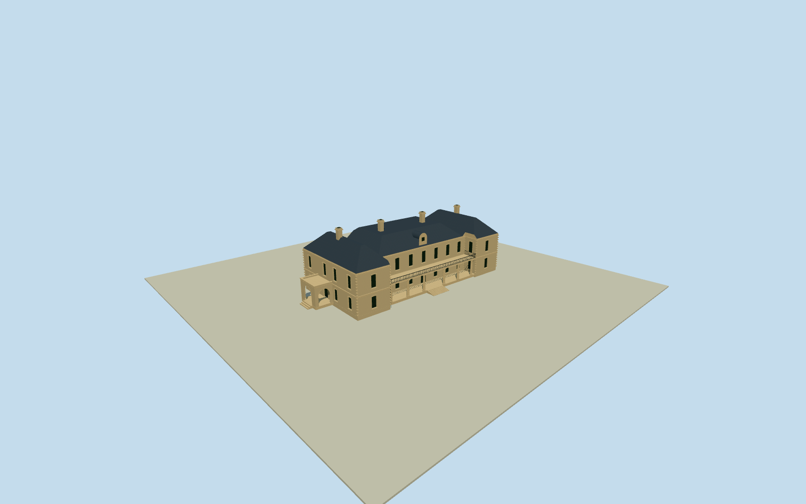

# Jimbour Homestead

Whole principalJimbourHouse: actual12controlstonebody/projectingendwings/twostoreys, threehippedslateroofparts/roundedcentraldormer/fourchimneys, longopenpairedDoriccolumnveranda/balcony/centralstairs and actualthreeopenarchesofintrinsicsideportico. Two exactpublished1925front/1928sideSLQPDoriginals, nativewholewallplan. Derivedveranda/porch explicitlyextendbeyondnativewalloutline; estate/detachedbuildings/gardens/interiors excluded. Hiddenroof/rear/census/colors/repairs bounded estimates.

Authoring state: **review-in-qa.json**. Current completion evidence is in [qa.json](qa.json) and the [completion ledger](../../../../qualla-structures/batches/qualla-002.PROGRESS.md).

- [Jimbour Homestead](https://qualla.com/jimbour-homestead/)

Current closed native12-control principal JimbourHouse buildingway284368616. Paired projecting front/rear endwings and notched central body retained at actualmetricXZ. Publishedfront/side1925/1928photos establish intrinsicfrontveranda and openarchedsideportico, which are explicit derivedphysicalparts beyond the mapped wall outline. Not the entireestate/siteparcel/detachedhangar or otherbuildings.

Whole surviving principal JimbourHouse homestead: two-storey sandstone mainbody, longcolumnedfrontveranda/projectingendbays, centralhippedslateroof/dormer/chimneys, intrinsic sidewings and archedsideportico/entry. Resolve wholecurrent physical plan before geometry; exclude entireestate, gardens, fences, separateoutbuildings/chapel/woolshed and interiors.

Originalindependent256m129field/16641samples/two raw tiles/nativebboxanchor/heading0/SWdatum369.7805m frozen before once-onlyfloor10.205m and mainsections. Two archived PDfront/side photos bound estimatedplatform.6m/upperfloor4.9/wall9.7/centralhipridge13.2/endwinghipridge13.8/fourchimneys15.9/longopenveranda12columns/balcony and threeopenarchedsideportico. Native12wallcontrols fixed; veranda/sideporch derivedintrinsicarchitecture explicitly beyond walloutline, not estatepad. Windowcensus/hiddenrear/roofjoins/colors/repairs estimates. No later floor/mainsection/originalfield tuning.

Two exact1925front/1928side1000px SLQpublic-domainoriginals supply exteriorarchitecture; unrecordedarchivephotographer explicitlybound by existingprimarygrantverifier. No circa1890alteredroofstate/protectedmodernphotos/gardenpixels/inscriptions used. Currentcolors/roofdivisions/hiddenrear/windowcensus/details/repairs are originalboundedestimates, not currentsurvey/photogrammetry.

All12nativewallcontrols preserved; attachedverandafloor/colonnade/balcony/sideportico/stairs are explicitlyphoto-derivedintrinsicarchitecture, not native-taggedmeasurements or a sitepad. Threeopenarchesretain genuinevoids at everyLOD. Separatehangar/chapel/outbuildings/estate/fences/gardens/interiors excluded.

Original256m129field/nativeframe/floor/mainsectionsfixed beforegeometry, no laterfit/flatten/reframe/reacquire/replacement/raising. Contactunverified/geographicpreview/replacementfalse. Reviewground and syntheticneighborbuildings are fixtures.

Build: `node content/worldgen/source/places/r7/r75/jimbour_homestead/models/generate-jimbour-homestead.mjs`. Add `--check` to verify exact regeneration. 16947 triangles; 5 materials; no embedded photographs.
