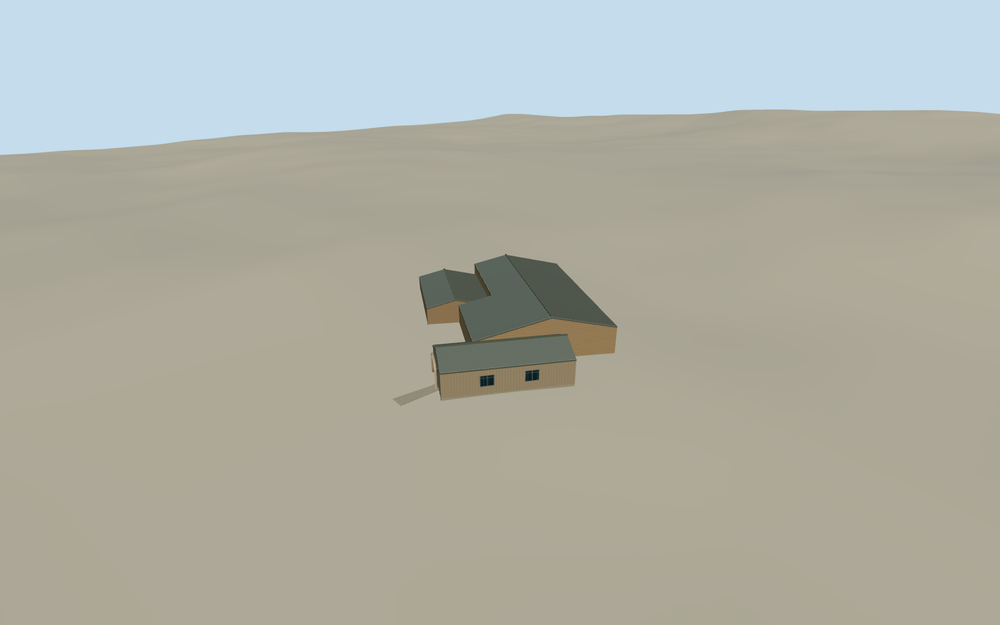

# Abbey Museum of Art and Archaeology

The Abbey Museum of Art and Archaeology at Caboolture with the connected gallery wing and step-free glazed entrance.

Authoring state: **review-in-qa.json**. Current completion evidence is in [qa.json](qa.json) and the [completion ledger](../../../../qualla-structures/batches/qualla-003.PROGRESS.md).

- [Abbey Museum of Art and Archaeology](https://qualla.com/abbey-museum-of-art-and-archaeology/)

The museum outline and the pedestrian path to the entrance come from the map. The dataset repeats the same measured outline, so the exact exterior changes and boundary of the 2024 extension are approximate.

The museum confirms a flat entrance with automatic glass doors. Its published design describes an arch that is represented here as estimated. Roof heights, gable and skillion divisions, cladding, and service openings are estimated.

Build: `node content/worldgen/source/places/r7/r7h/abbey_museum_of_art_and_archaeology/models/generate-abbey-museum-of-art-and-archaeology.mjs`. Add `--check` to verify exact regeneration. 649 triangles; 7 materials; no embedded photographs.
