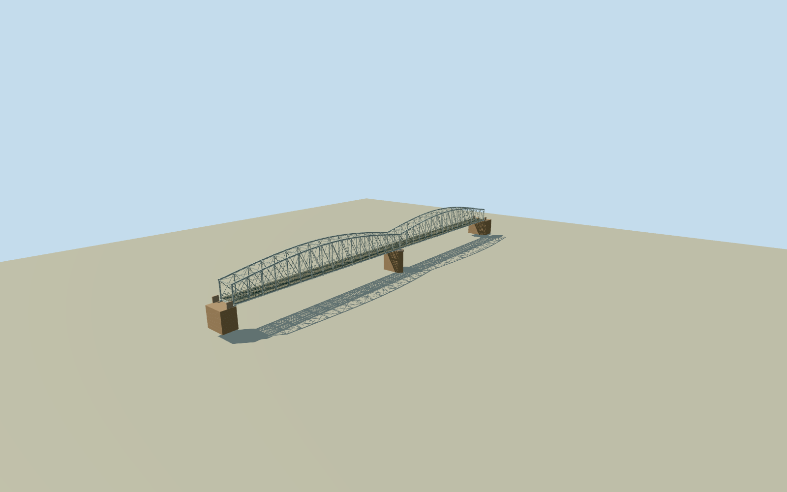

# Albert Bridge, Brisbane

Whole surviving1895AlbertBridge/native207.64msteelspanextent and9.61mwidth: two paired hogback through-truss spans, lower/curvedtopchords/verticals/doublelattice/portal knees/upperwindbracing, open twintrackdeck/rails/sleepers/stringers/crossgirders/underXbracing, one central masonrycutwaterpier/ownbothbankabutments/nativeendjogs/bearings. Palegrey rivetedsteel/builtupflanges/gussets and warmfreestone masonry; only1895bridge, not its distinctneighbours.

Authoring state: **review-in-qa.json**. Current completion evidence is in [qa.json](qa.json) and the [completion ledger](../../../../qualla-structures/batches/qualla-002.PROGRESS.md).

- [Albert Bridge, Brisbane](https://qualla.com/albert-bridge-brisbane/)

Exact named surviving AlbertBridgeway620779380/Q4709800 full14nonduplicate OSMpolygon supplied at fullprecision by Nominatim native lookup. Two actual long parallel deck sides7to8/11to12 identify north/south steel ends; nativecomplete south own abutment/endjogs retained. Original fullOSM endpoint is rate limited so node IDs unavailable; no invented vertex IDs or survey claim. Whole2hogbacksteeltrussspans/nativelength and width, not adjacent1957upstreamrail/JackPeschfoot/WalterTaylorroadbridges. Lowerpier/floor/trussheight/panelcensus/hiddenbankabutments/catenarysections estimated. Fixed NEbankapproach before independent terrain and geometry; do not use riverwater as floor height. Native steel-endcenter separation207.64299591696968m/nativewidth9.612554754788912m governsgeometry; no fit to roundedpublishedspanlength. Native man_madebridge layer2has no numericheight/decksurvey. Anchor[152.973998975,-27.5059466]andactualNEdeckaxisheading2.779060938559663rad,+ZIndooroopillyNE/+Znorthbank. Exact full14sourcevertices retained includingown southern endjogs. FixedNEbankapproach[0,121.82149795848484]chosenbefore independentterrain/geometry; modelraildeckY0 and underdeckpiersnegativeY, not riverwaterasfloor.

Entire surviving1895two-span bridge/nativefull14vertexoutline/ownendjogs,207.64299591696968msteellength/9.612554754788912mwidth and onecentralmasonrypier retained. Governmentheritage text confirms two hogback trussspans/centralpier/materials/originalbankabutments; no lost1876bridge or distinct1957rail/JackPeschfoot/WalterTaylorroad bridge substitution.

Only exact already-published1024x683PaulGuardQualla2008ownphotograph/nativeSHA1/explicitPD-user-enrelease. Observed palegrey rivetedsteel chord/vertical/lattice/floor crossgirders/stringers/underbracing/open deck and masonrypier control near section forms; no historical/unknownauthor/attribution/unrelatedimagery. Governmentarchive primarytext facts only, its1896image unused. No copiedpixels/generatedbitmap.

Allverticalsections/deckheight/pierdepth/bankabutmentprofiles/curvedchordheight/panelcensus/hiddenupperbracing/trackgauge/rail/slat/catenary sections are explicit photographic medium-fi estimates.16panelsper103.82mspan is representative, not surveyed. Near double lattice/open rail/sleepers/crossgirders/overheadtrainpassage retained; close adds actual flange/webbuiltup sections/gussets/originalrivets. Skyline uses ribbon truss/alternating diagonal proxies/coarse topcurve/flatdeck, district open uncapped member proxies/coarse ties/rails within small section errors. Deep buriedcaisson/foundations notsurveyed or claimed.

Independent600m151x151at4mTerrariumfield/rawtiles/grid/PNG preserved without fitting/flattening/clipping. FixedNEbankapproach[0,121.82149795848484] provider5.671m precedesgeometry; it is not a surveyed rail elevation.31extreme negative provider cells are all outside exactnativebridgefootprint and retained only as diagnostic evidence, never as credible bridge/riverfloor. Nativefootprint samples3..19.6226m mayincludeDSMbridge/vegetation. Exactrailgrade/riverdatum/pierfoot/deckvsDSMclassification/hostcontact remain unverified; geographicpreview/replaceFootprintfalse. No river/water/groundbank/landscape/roads/houses/people/trains/signage.

Build: `node packages/worldgen/scripts/generate-authored-places.mjs --ids=albert_bridge_brisbane`. Add `--check` to verify exact regeneration. 26340 triangles; 4 materials; no embedded photographs.
