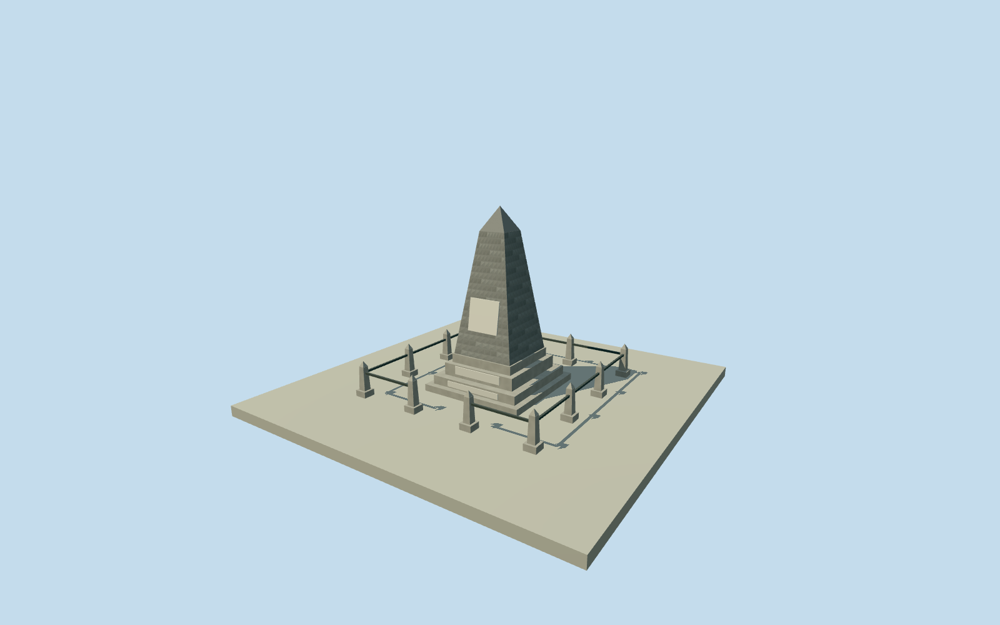

# Allan Cunningham Monument — Cunningham’s Gap

Whole Allan Cunningham Monument at Cunningham’s Gap: stone obelisk/cairn, integral stepped cement-rendered base, three south-facing marble plaques and its low post-and-single-rail enclosure. Forest, highway, natural mountain, tourist shelter and later unrelated monuments are excluded. A primary-text reconstruction of the simple structure; main height/base dimensions follow the Queensland heritage authority. Taper, step divisions, stone pattern, plaque sizes, enclosure size and small fittings are bounded estimates. No archive photograph used or photographic fidelity claimed.

Authoring state: **review-in-qa.json**. Current completion evidence is in [qa.json](qa.json) and the [completion ledger](../../../../qualla-structures/batches/qualla-002.PROGRESS.md).

- [Allan Cunningham Monument](https://qualla.com/allan-cunningham-monument/)

Whole Allan Cunningham Monument at Cunningham’s Gap: stone obelisk/cairn, integral stepped cement-rendered base, three south-facing marble plaques and its low post-and-single-rail enclosure. Forest, highway, natural mountain, tourist shelter and later unrelated monuments are excluded. A primary-text reconstruction of the simple structure; main height/base dimensions follow the Queensland heritage authority. Taper, step divisions, stone pattern, plaque sizes, enclosure size and small fittings are bounded estimates. No archive photograph used or photographic fidelity claimed.

Primary description gives approximately 5m height and 3m square base. Internal stepped-base divisions, shaft taper, pointed cap, individual stone shapes, plaque sizes/placement, enclosure dimensions and exact 2022 finish are reconstruction estimates. No photograph was used for proportions, tracing, colors or textures; no photographic fidelity is claimed.

Three south-facing marble plaques are retained as simple panels; exact lettering is not reproduced. The enclosure is represented by twelve pointed concrete posts and single metal rails with a southern access gap; precise layout and post dimensions are estimates.

Native memorial point is independently matched to the named primary heritage site and nearby Wikipedia coordinates. It is not a surveyed footprint. Source terrain is an unchanged independent 128m field; canopy/coarse DEM relief and foundation contact are approximate. No forest, arbitrary rock terrain, highway or shelter is part of this asset.

Dated 2022 representation follows the heritage record; it is not certified as an automatic current-world replacement.

Build: `node content/worldgen/source/places/r7/r7h/allan_cunningham_monument/models/generate-house.mjs`. Add `--check` to verify exact regeneration. 3586 triangles; 4 materials; no embedded photographs.
