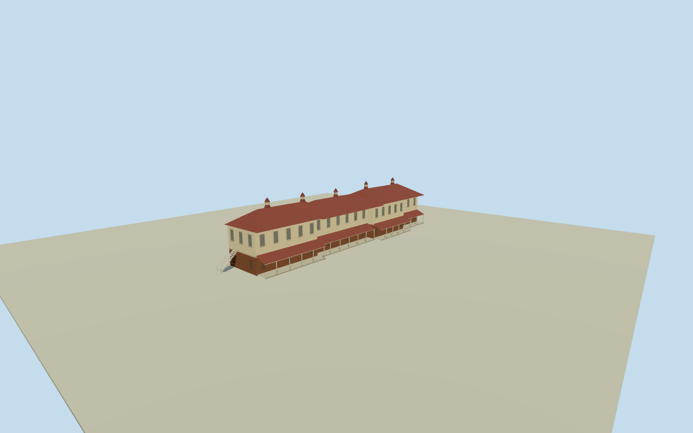

# Blair Pavilion, Ipswich

Federation-era Blair Pavilion with its long veranda, brick base, cream walls and red roofs with five ventilators.

Authoring state: **review-in-qa.json**. Current completion evidence is in [qa.json](qa.json) and the [completion ledger](../../../../qualla-structures/batches/qualla-003.PROGRESS.md).

- [Ipswich Mental Hospital](https://qualla.com/ipswich-mental-hospital/)

Exterior represents the photographed Blair Pavilion at the former Ipswich Mental Hospital site. Other hospital buildings and interiors are outside the model.

The location and footprint derive from an approximately registered university campus plan. Window details, roof junctions and rear elevations are estimated.

The original terrain is preserved. Veranda and exterior stair footing heights remain approximate.

Build: `node content/worldgen/source/places/r7/r7h/blair_pavilion_ipswich/models/generate-house.mjs`. Add `--check` to verify exact regeneration. 2488 triangles; 6 materials; no embedded photographs.
