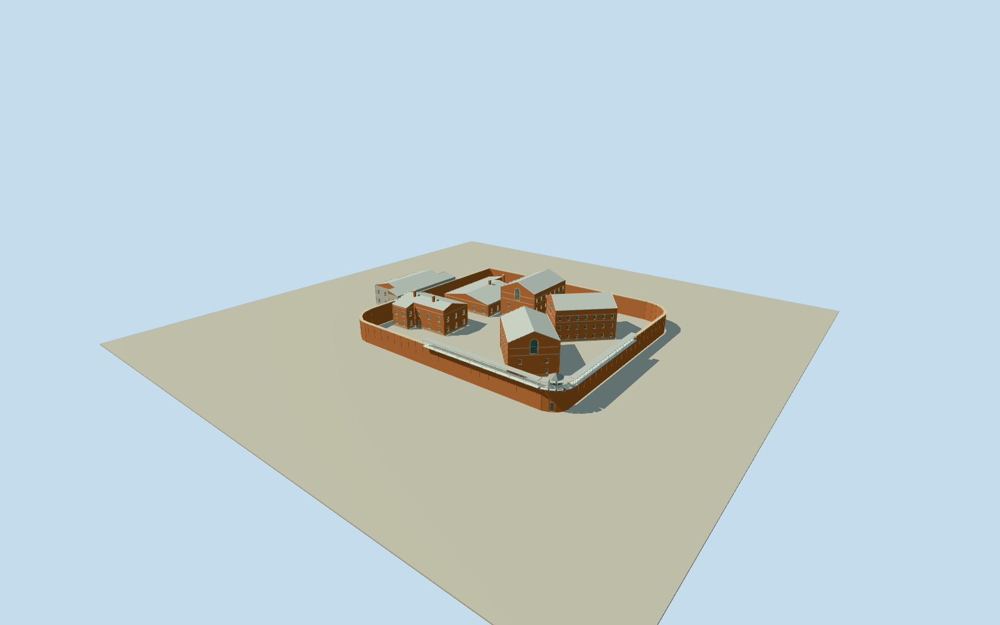

# Boggo Road Gaol

Whole surviving gaol: all7nativebuilding-roof plans/three3storeycellblocks/auxiliaries/northretainedblock/openroof, actual19vertex6mbrickwall/own gates and SWpaleguardbooth/facetedroof/externalcoveredcantileverwalkway. Recessedbarredlights/buffbands/archedgablegallerywindows/corrugatedpale roofs/brickchimneys. Propertyidentity34ring stays emptyyards/no sitefloor; no demolishedlargeNo1complex/modernneighbors.

Authoring state: **review-in-qa.json**. Current completion evidence is in [qa.json](qa.json) and the [completion ledger](../../../../qualla-structures/batches/qualla-002.PROGRESS.md).

- [Boggo Road Gaol](https://qualla.com/boggo-road-gaol/)

OriginalnamedBoggoRoadGaolpropertyway35841181/Q4937584retains34nonduplicateboundaryvertices, identityscopeonly/notasolidsitefloor. Actualclosedbrickwallway1563719295retains19nonduplicatevertices/estimated6mheight/0.75mwidth. All7currentnativebuildings/roof retained:3storeycellblocks1002265560/5561/5565(4verticeseach),2storeyaux1002265563(6),1storeyaux1002265566(8),openroof1002265564(4),northretained2storeyblock1563719294(12); allactualrelativepositions. Nativelevels control verticalstoreycensus; sections/ridges/windowrepeatandnorthernblockrole/finishestimated. Fullnativeanchor34vertexmean[153.02879034411765,-27.494977773529413]; exactlongwesternwall5to6 fixes frontWNWheading-1.7647581634901301rad. SWguardboothcenter follows roundedSWwallcornermean1to5[63.62719583151092,40.78402547892432], width/roof/platform and northgateopeningphotographic/functionalestimates. FixedWNWfrontapproach[30.462559308045734,48.310764444045375]sixmetresoutsidewall beforeterrain/geometry. ModernVillageway1308720187/Ecosciences58458585 andotheroutsidebuildings excluded. No surveyedfloor/threshold/groundcontact.

Wholecurrentnamedcompoundarchitecture: all3three-storeycellblocks/2auxiliaryblocks/fullnorthernretained2storeyentry-remnantblock/openpostedshelter andactual19vertexbrickwall/guardbooth/gallery. Property34ring is identityonly, not a courtyard/site slab. No demolishedlargeNo1wings/rebuiltlostprison or modernBoggoRoadVillage/Ecosciences/houses.

ExactQualla2015Shiftchange3264x1717ownCC0photo/nativeSHA1/explicitgrant only; fullreference andnativecompleteplan inspected. Itestablishes redbrickwall/pilasterrhythm/palesuspendedoutergallery/brackets/SWwindowedguardbooth/hiproof, tallcellgable/archedbarredlight/buffband/corrugatedpale roofs/chimneys. Historicalaerials/nullauthor/attribution/interior/unrelatedimages unused; no supplementalphotos/copiedpixels/generatedbitmap. Operator/historicalsocietytextfacts only, theirphotos/maps/drawingsunused.

Native3/2/1storeycensus and fullfootprints retained;6mwall primaryheightcontrol. Allothersectionheights, guardbooth/window/roof sizes/gallerylength, finecellwindow/bar/chimneycensus/hiddenroofpartition/northernblockrole and finish estimated. Northernretainedblock representedwithrestrainedpaleconcretefinish without certifiedgatehouse/visitor/No1cellclassification. Functionalnorthentrygate/closedback andSWfootdoor areboundedestimates; smallcelllights are unglazed recesses with closed shadowbacks, no interiorcells/people/exhibits. Skylinecoarsens smallapertures/galleryposts/cabinpanes; district uses flatglazing/shadow and coarser details; nearlevels add real barredrecesses/archedgallerywindows/gablebands/roofrims/cabincladding.

Independent240m161x161at1.5mfield/2rawtiles/grid/PNG frozen beforegeometry. FixedWNWfrontapproach[30.462559308045734,48.310764444045375], provider36.6026m, relativefield[-9.5241,3.0498] unchanged; no flattening/fitting or addedyardfloor. Modelcommonfloor/wallbase/steps/threshold and actual hostterraincontact unverified; geographicpreview/replaceFootprintfalse. No landscape/roads/temporaryworks/signage.

Build: `node packages/worldgen/scripts/generate-authored-places.mjs --ids=boggo_road_gaol`. Add `--check` to verify exact regeneration. 23959 triangles; 6 materials; no embedded photographs.
