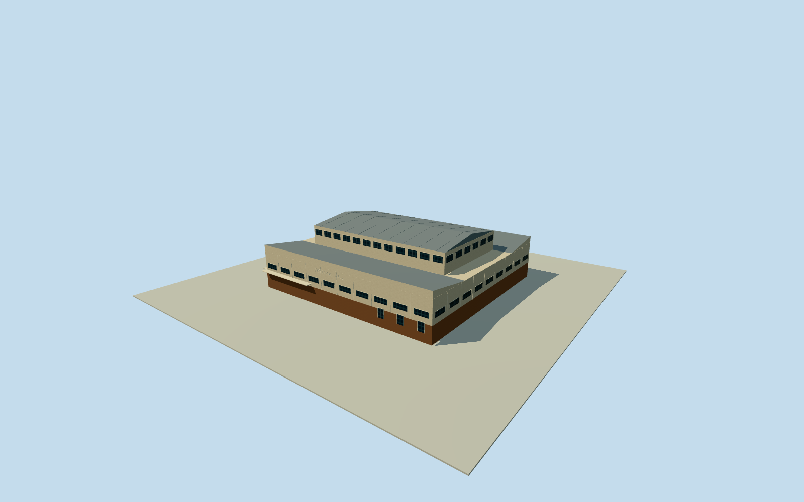

# Brisbane Festival Hall — whole historical hall and roofs

Whole1958-59BrisbaneFestivalHall historical physical building, entire multipurpose hall/podium/foyers/allfacades and all raised central auditorium/side seating roof volumes. Original2002ICOMOSconstruction/form assessment and originaldesigner first-person oral-history written transcript. IndependentQ4968565point and actual numerical Charlotte/Albertstreet controls supply context only; no surviving mapped historical outline. All original plan/height/section/roof/profile/fenestration/finish/grade estimates explicitly bounded. No1925predecessor/modernFestivalTowers/FortitudeMusicHall/StateLibraryproxy. Historical2002 only, demolished2003, no current replacement.

Authoring state: **review-in-qa.json**. Current completion evidence is in [qa.json](qa.json) and the [completion ledger](../../../../qualla-structures/batches/qualla-002.PROGRESS.md).

- [Brisbane Festival Hall](https://qualla.com/brisbane-festival-hall/)

Whole1958-59BrisbaneFestivalHall historical physical building, entire multipurpose hall/podium/foyers/allfacades and all raised central auditorium/side seating roof volumes. Original2002ICOMOSconstruction/form assessment and originaldesigner first-person oral-history written transcript. IndependentQ4968565point and actual numerical Charlotte/Albertstreet controls supply context only; no surviving mapped historical outline. All original plan/height/section/roof/profile/fenestration/finish/grade estimates explicitly bounded. No1925predecessor/modernFestivalTowers/FortitudeMusicHall/StateLibraryproxy. Historical2002 only, demolished2003, no current replacement.

Original2002AustraliaICOMOSHeritageAtRisk primary assessment describes substantially intact1958-59multipurpose hall, clean-lined international-modernist Charlotte/Albertfacades, raked seating atnorth/south sides expressedinCharlotteStreet elevation and raised central auditorium roof over boxingring. Original2012designerPeterHeathwood oral-history transcriptPDFpage18 says actual built shape followedhisdesign but structure didnotpreciselyfollowhisdrawings. Both originalHTTP200documents cached/hashbound, all photographs/sketches/audio/video/drawings unused. No retrieved original1959plans or structural-engineering fidelity claim.

Independent historicHallQ4968565point and six original quantized Charlotte/Albert street controls supply context/orientation only. Historical Hall footprint absent after2003demolition. Modern FestivalTowers parcel/building/135mroof is not used as historical Hallplan, no1925Stadium/FortitudeMusicHall/StateLibrary substitute. Entire physical historical hall/allfoyers/podium/facades/centralraisedroof/side seating wings included.

Whole historical plan is expressly estimated, chosen after original frame/independent256mfield but before floors/mainsections: rectangle x-15..45m,z-28..29m,60x57m. This fits the independently mapped corner frontage context, not a measured hall outline. Nominal20percentplan/10m component registration uncertainty. Original publishedpoint lies inside estimated building; independent AlbertStreet atxabout-24m and CharlotteStreet atzabout37.4m remain context, never reclassified as building walls.

Estimated providerrelativefloor0.4m/basementbottom-2.1m/mainhallwalltop9.4m. Central raised auditorium rectanglex-9..39m,z-13.5..14.5m, eave15.4m/ridge17.4m; ridgealongCharlotteStreet localX andestimatedgablecrosssection. Side seating roofs rise frominner9.4m toouter11.4m overbothcomplete sidewings; endfoyerroofs9.4m. Exact roofprofile/pitch/shape/section registration unknown; primaryonlysupports raisedcentre/rakedwings, these precise profiles explicitlyestimated, not architectdrawings/photos. Nominal3m heightuncertainty. All mainsections/floor/sourcefield preserved through review.

All foyer/entry/canopy/window/door/clerestory/bay/pier/roofrafter/fascia/drain census/proportions/positions estimated. Creamrender/brickbase/darkwindow/paintedmetalroof finish approximate. Basic original geometric FESTIVALHALL name lettering may be used as estimated signage, no historical logo/design/source-pixel trace. No copied poster, mural, sculpture or other artwork. Interiors/stage/seating exact layout excluded, whole exterior andintrinsicroofvolumes retained.

Original current independent256m/16641-height providerfield acquired before floor/mainsections; originalframe/rawtiles/grid/heightmap retained. Modern urban roof/canopy/DEM artifacts and currentproperty redevelopments are not original2002ground. Ground/vertical historical registration unverified; source may overlap/bury lower geometry or leave apparent float. No mask/cutout/flatten/refetch/refit/floor adjustment for review.

Historical2002-01-01 intact1959Hall only, valid until2003-01-01. Later2003demolition acknowledged, no current-world replacement. Qualla-first25families, every source photograph/figure/sketch/video/audio unused. Questionable sources skipped without questions or rightsrepair. Original written primaryfacts and independentnumericstreetcontext only; no photographic/survey claim.

Build: `node content/worldgen/source/places/r7/r7h/brisbane_festival_hall/models/generate-house.mjs`. Add `--check` to verify exact regeneration. 5092 triangles; 6 materials; no embedded photographs.
