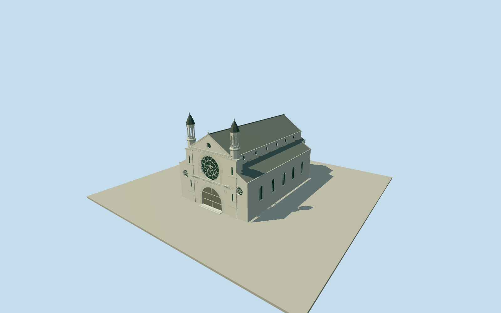

# Brisbane Synagogue

Complete surviving1886synagogue on its original six-vertex whole outline/rear jog. High nave/gabled roof and lower side aisles, pale rendered street facade, deep round rose/portal arches and original circular/flower tracery, twin octagonal towers with open upper arcades/pointed faceted spires, geometric friezes/gable vent and intrinsic threshold steps. Exact published1949public-domain facade and current native plan; hidden height/roof/side/color estimates. No neighboring buildings, grounds, signs or interior.

Authoring state: **review-in-qa.json**. Current completion evidence is in [qa.json](qa.json) and the [completion ledger](../../../../qualla-structures/batches/qualla-002.PROGRESS.md).

- [Brisbane Synagogue](https://qualla.com/brisbane-synagogue/)

Whole original native synagogue building way49748178, all six nonduplicate exterior vertices/nodeIDs retained, including small rear jog vertices1/2/3. Name/religion/street address98Margaret Street match the story/source facade. Exact vertex-mean anchor[153.02694359999998,-27.473283133333336]. Actual short southeast street-facing edge4to5 fixes heading0.694563611421631rad and the full facade axis. Central entrance position within that edge is a photographic estimate, not a mapped doorway node. Original edge midpoint[-1.7453225309977514,14.71767062448226]plus3m outward fixes approach[-1.7453225309977514,17.71767062448226]before independent terrain/geometry. Upper nave/aisle partition, towers/rose/roof heights, cropped doors and current finishes are photographic estimates; no grounds or neighboring roofs added.

Complete current whole synagogue envelope/native rear jog, high nave and lower aisles. Front arcades/spires, round rose/portal/side lights and geometric moulding/friezes are original authored geometry, not copied stained-glass pixels. No whole grounds/site pad, neighbors, fence/people/birds/wires, signs or interior.

Only unconflicted exact803x1000published1949SLQoriginal, native SHA1076740f84a9c004b2c37d9826ff56866b1463d5b and explicit public-domain archive grant matched. Full37source families inventoried; conflicting1906hero/relief-map path excluded, all other exterior/first-synagogue/interior/portrait/attribution imagery unused. No supplementary photography/copied pixels/generated bitmap.

Current six-point plan and actual Margaret Street edge retained. Main nave/aisle split,12.5m ridge/15.3m tower tips, rose/tracery/arch dimensions, hidden wall/roof/door census, tower profiles and current finish after1949 are bounded estimates from one cropped monochrome facade. Neutral pale render/dark metal/wood/glass palette is not a historic or current color survey.

Independent96m129x129at0.75m terrain, fixed approach[-1.7453225309977514,17.71767062448226], provider30.7177m/full relative[-13.5052,14.715]. Raw tile/grid/PNG unchanged without clipping/fitting/flattening. Coarse composite urban elevations may include neighboring roofs and vegetation; precise synagogue foot/threshold/steps/host contact unverified. Geographic preview; replaceFootprint=false.

Build: `node packages/worldgen/scripts/generate-authored-places.mjs --ids=brisbane_synagogue`. Add `--check` to verify exact regeneration. 12348 triangles; 6 materials; no embedded photographs.
