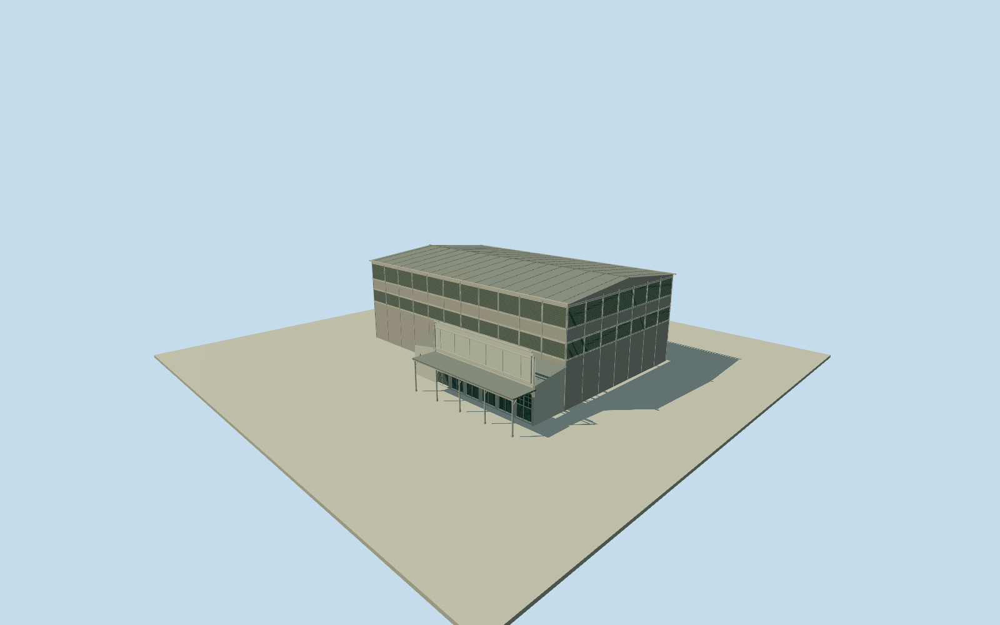

# Cremorne Theatre, Brisbane (circa1934)

Historical circa1934 original Cremorne Theatre: whole tall hall/canvas-like wall panels, continuous dense upper and lower louvre banks, gently pitched roof, own low entrance annex/sloping cap, blank stepped/scalloped parapet, gridded door leaves/two pointed vents and thin projecting canopy on slender posts. Approximate photo-ratio footprint/roof/color/facing and archival site anchor. Historical1934only; no modern QPAC venue/gallery or street context mesh.

Authoring state: **review-in-qa.json**. Current completion evidence is in [qa.json](qa.json) and the [completion ledger](../../../../qualla-structures/batches/qualla-002.PROGRESS.md).

- [Cremorne Theatre](https://qualla.com/cremorne-theatre/)

Historical circa1934 original Cremorne Theatre only. Exact published archival file location[153.01873,-27.47262]retained as approximate site anchor, not a surveyed building centre; positional uncertainty about30m. No original footprint survives or is mapped. The30x18m hall and12/13x4m entrance annex outline is an explicit photo-ratio reconstruction, with concealed depth/dimensions and slightly gabled roof estimated. Current Cultural Centre Tunnel way530172035 retains original three coordinates solely as modern street context, never the old theatre footprint or a claim that current tunnel is the1934road. Visualization street-facing axis is perpendicular to this present contextual axis, roughly southwest; old street alignment and plaque/front facing are approximate by60degrees. The native archival caption places the theatre on the riverbank side of former Stanley Street between Peel and Melbourne. Archival point identity, approximate orientation and reconstructed extent are separately labelled. Modern gallery/campus excluded. Fixed approach[9,18]before independently sampled modern terrain/geometry;1934grade and host contact are not established.

Historical-only representative1934appearance, valid1934-01-01through1935-01-01for dated opt-in. Native archival citation says circa1934, not2014capture. Original burned1954and never rebuilt; no modern QPAC namesake/gallery/streets/neighbor shops or interior represented.

Only exact already-published1000x744 SLQ/John Oxley Library1934 exterior, native SHA19ad8bc9f9324a49c307cca073f2ecdf938280d6c and explicit PD-Australia matched. Six source families inventoried without conflicts. Other posters/performer/interior/attribution images unused; no supplemental photography/copied pixels/generated bitmap.

All dimensions are estimates from one monochrome exterior:30x18m complete hall/10.75m ridge, low own annex/6.55m blank entrance parapet, louvre bays/blades, door leaves/frames, hidden rear/roof profile and canopy/post census. Muted canvas/lime/painted timber/metal roof and glazing colors are medium-fi interpretations, not a historic color/material survey. Recessed closed louvre backs avoid fabricating an interior.

Exact archival site coordinate retained as approximate anchor with about30m uncertainty; original corners/footprint/facing are not mapped. Current tunnel line is modern orientation context only; visualization front approximate by60degrees. Own bounded photo-reconstructed extent, no false original native outline or contemporary geographic activation.

Independent96m129x129at0.75m modern terrain, fixed approach[9,18], provider9.7675m, full relative[-2.6316,4.0578]. Raw tile/grid/PNG unchanged without fitting/flattening/clipping. Oversamples4.24m output pixels/coarser DEM; current gallery grading differs from1934, precise historic foot/threshold/host contact unknown. replaceFootprint=false.

Build: `node packages/worldgen/scripts/generate-authored-places.mjs --ids=cremorne_theatre`. Add `--check` to verify exact regeneration. 11768 triangles; 6 materials; no embedded photographs.
