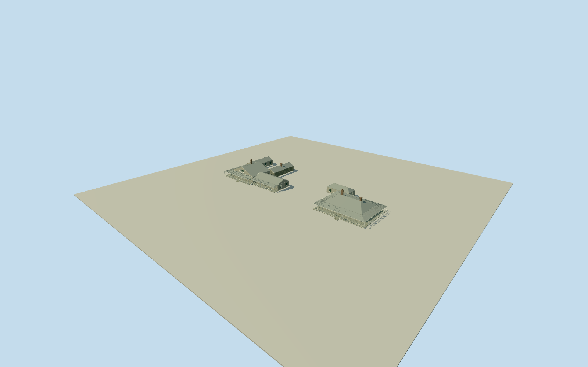

# Cressbrook Homestead

Distinct main House and Cottage with complete intrinsic domestic wings: gabled attic House/front window and small white-railed balcony, long low veranda wing and rear slab/kitchen roofs around an open courtyard; broad low hipped Cottage with wrap veranda, service hip, timber posts/rails, doors/windows and paired brick chimneys. Four accepted archival exterior originals. Photographic plans, metric spacing and hidden dimensions are estimates; no parcel slab or separate chapel/farm buildings.

Authoring state: **review-in-qa.json**. Current completion evidence is in [qa.json](qa.json) and the [completion ledger](../../../../qualla-structures/batches/qualla-002.PROGRESS.md).

- [Cressbrook Homestead](https://qualla.com/cressbrook-homestead/)

Two named main Cressbrook homestead dwellings only, retained as distinct photo-guided House and Cottage with attached domestic wings/verandas. Official QHR600503heritage parcel centroid[152.40455145, -27.05836679]anchors the assembly; it is NOT a surveyed house centre or building corner. Qualla/Wikidata point is coarse (~0.01degree precision). Saved OSMquery contains no original building plans; unrelated Nominatim Brisbane street results rejected. All component outlines, metric dimensions, courtyard size and separation are explicit photographic reconstructions, not native mapped footprints. Primary heritage text places the homes toward the north of the site and House front northward with a rear southern domestic courtyard. Visualization +Z north (heading pi), +X west. House centre[-30,42]and Cottage[30,42]metres relative to parcel centroid, their60m separation, relative east/west order and offsets are approximate with at least60m registration uncertainty. A separate chapel/whole property is not substituted. Fixed north House approach[-30,55]chosen before terrain/geometry; floor/stumps/steps and exact current host contact unverified.

Both named main dwellings retained with their distinct gabled/attic House and hipped Cottage profiles, domestic wings/verandas and own floors/stumps/steps. Open rear House courtyard and intervening gap; no parcel/site slab, separate chapel/stables/dairy/worker homes/tanks/farm sheds, landscape/river/trees/fence/tennis court/people/interior.

Four exact unconflicted already-published Qualla originals: named Cottage SLQ1 95648, Homestead1930SLQ2 232995, front ca1930SLQ1 92936 and rear1899SLQ1 71327. Native originals/hashes, archive item handles and explicit PD-Australia/StateLibQld-License matched; unrecorded creators established by exact native archive records. Full15source families inventoried. All other media unused; no supplementary imagery, copied pixels or generated bitmap.

Photographs establish exterior roof/veranda/attic/slab/chimney forms; component dimensions, House6.9m/Cottage6.1m roof ridges, House/Cottage60m spacing and relative east/west position, hidden aperture/roof census, current colors/finish and exact ground contact are declared estimates. Neutral timber/metal/brick/glass palette is not a historic/current color survey. Official site centroid anchors a photo reconstruction, not mapped building corners.

Independent192m129x129 field at1.5m,16641 samples from two original Terrarium tiles. Provider87.8798m, whole relative[-1.1564,5.5846]m at fixed approach[-30,55]. Original grid/PNG unchanged without fitting/clipping/flattening. Oversamples4.2544m source pixels; composite rural DEM can include vegetation. Geographic preview only, replaceFootprint=false; exact house-floor/stump/step/host contact unverified.

Build: `node packages/worldgen/scripts/generate-authored-places.mjs --ids=cressbrook_homestead`. Add `--check` to verify exact regeneration. 24740 triangles; 6 materials; no embedded photographs.
