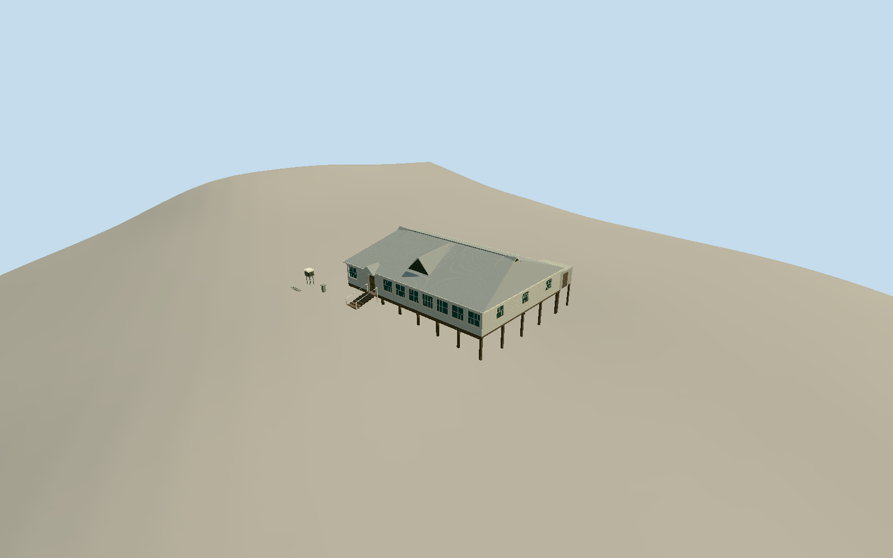

# Crohamhurst Observatory

Whole surviving1935 timber observatory: actual front rectangular roof extent, low timber stumps, weatherboard body and currently enclosed north/east casement verandas, hipped fibre-cement roof with north/east/west louvred gablets and entry gable, attached southwest shed, and intrinsic Stevenson screen, low temperature-pit caps, remnant instrument strip and sundial/telescope-marker stands. Separate later residence/eastern house/workshop, trees/private garden/fences/cars/people excluded.

Authoring state: **review-in-qa.json**. Current completion evidence is in [qa.json](qa.json) and the [completion ledger](../../../../qualla-structures/batches/qualla-002.PROGRESS.md).

- [Crohamhurst Observatory](https://qualla.com/crohamhurst-observatory/)

QRA public building-vector feature1730744 gives the northern/front rectangular333.265m² roof, 21.235276910457262m along north frontage and 15.756809327181642m depth, aligned with road approach and consistent with1935 building form/QHR siting. It is geometrically identified as the observatory from relative front placement/rectangular hipped form, not a named QRA semantic label; this identity is an explicit supported inference. Automated TWOSTOREY/slab/floor labels are not a building survey and do not override primary single-storey timber-stump description. Distinct eastern210.90m² feature1730737 and southern201.13m² feature1730767 are excluded. Original footprint is metric data rather than interpreted from licensed aerial pixels. Southwest shed projection/instrument positions are bounded estimates from primary relative-location text, not mapped roof parts. +X east-northeast along north frontage; -Z north-northwest toward road.

Before geometry, level observatory/shed floor fixed0.65m above independent north-east/uphill corner sample[9.617638455228631,-6.878404663590821]. Low stumps at that corner, with longer exposed toes on the downhill west; original opening photo also shows falling ground and exposed posts. Support toes alone consume the unchanged field. Native QRA automated slab/floor/class labels are not a floor survey and are not fitted to the independent Terrarium datum. Coarse source DEM may include vegetation/building effects; exact stumps/steps/grade contact unverified, geographic preview approximate and replacement disabled. No terrain flattening/fitting/reacquisition.

Whole surviving single-storey timber observatory and intrinsic weather instruments, with current enclosed north/east weatherboard/casement verandas, hipped fibre-cement roof/three louvred gablets/entry gable, genuine open timber-stump underfloor, attached southwest lean-to and meteorological devices. No telescope dome, removed telescope, independent house/workshop, private garden/trees/people/vehicles/bunting or copied memorial text.

One exact1432x1003 expired1935 Courier-Mail opening photograph controls original roof/post/veranda proportions; it depicts the formerly open verandas, not current enclosures or all sides. Current enclosure/shed/instruments derive from official QHR602682 text, itself based on boundary observations/heritage photos rather than a complete site survey. Fine bay/door/vent census, sections, shed dimensions and instrument locations remain bounded estimates. Neutral light weatherboards/gray fibre-cement/painted frames inferred from grayscale/type, not copyrighted modern colour images.

Actual QRA public333.265m² front roof rectangle fixes21.235m by15.757m metric extent and bearing; its identification as observatory is a supported geometric/context inference, not an official named building label. Automated TWOSTOREY/slab/floor/height attributes are not accepted as literal construction facts. Eastern210.90m² and southern201.13m² independent roofs excluded. Shed projection and instrument layout are not separately mapped parts. Compatible independent ground required; provider DEM may include vegetation/surface effects, exact contact unsurveyed/replacement disabled.

Four LODs retain complete roof/three vent gablets/entry/current enclosures/open supports/attached shed and instruments. Near details restore recessed divided casements/weatherboard edges, attic and Stevenson slats, corrugation geometry, joists and entry rails. Six actual canonical surface slots, five shared graphs and local glazing. Fibre-cement roof uses rough concrete-panel binding with original corrugated geometry; small painted instrument supports use neutral trim approximation.

Build: `node packages/worldgen/scripts/generate-authored-places.mjs --ids=crohamhurst_observatory`. Add `--check` to verify exact regeneration. 4288 triangles; 6 materials; no embedded photographs.
