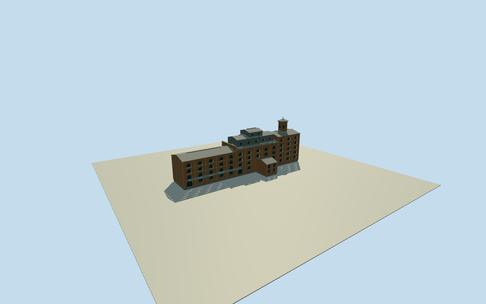

# CSR Refinery, New Farm — historic refining block

Whole circa1902 principal CSR refining building: thirteen brick bays, four/five storeys, arched twelve-pane openings and pilasters, five/eight-bay firewall, stepped corrugated upper storeys/ventilated gables, hexagonal char tower with coved cap/brackets/finial, suspended entrance awning and connected lower laboratory. Exact published Qualla public-domain SLQ originals. Historical approximate native registration and hidden rear sections; not modern apartment conversion or entire industrial site.

Authoring state: **review-in-qa.json**. Current completion evidence is in [qa.json](qa.json) and the [completion ledger](../../../../qualla-structures/batches/qualla-002.PROGRESS.md).

- [CSR Refinery, New Farm](https://qualla.com/csr-refinery-new-farm/)

Whole principal thirteen-bay1893 refining building and its photographed connected laboratory circa1902. Single unwarped orthogonal native frame; current way494955643 gives approximate99m length/17.5m depth, not measured historical wall vertices. Current rear projection omitted and historic laboratory depth12m is an original photographic interpretation. Main industrial block is complete on all sides, not a facade, whole parcel or detached-office substitution.

Original256m129x129 field acquired before all floors/main sections/mesh. Floor datum0 fixed at original landside[0,25] provider reference; foundation-1.2m. Four-storey south eave17.2m, middle18.2m, five-storey north22.2m. Setback metal storey24.0m/central raised section27.8m, hexagonal char tower body31.2m/coved cap33.8m/finial35.3m. Monochrome photo, primary bay/storey facts and original visual estimates; no surveyed historical grades, exact colors or current conversion claim.

Explicit historical circa1902 architecture only, nominal date1902 and interpretive1898..1908 availability; modern apartment openings/balconies are not documented by adopted images. No default current-world activation.

Current native whole outline retained independently. Historical lengths/depths/rear closure/connected laboratory phase/roof profiles/window census/frame detail/height/colors are original bounded estimates. Government text describes later industrial conditions and is used only for enduring form/bay/storey facts, not as proof of every1902 detail.

The1931 flood photo is low-resolution silhouette context, not independent detailed coverage. No neighboring works, detached office, boiler stack, wharf, river, people or modern apartments.

Original current coarse elevation may contain structures/canopy and cannot establish historical contact/ground classification/river level. Fixed frame/field/floors/main sections will not be fitted after modeling.

Build: `node content/worldgen/source/places/r7/r7h/csr_refinery_new_farm/models/generate-refinery.mjs`. Add `--check` to verify exact regeneration. 12608 triangles; 4 materials; no embedded photographs.
