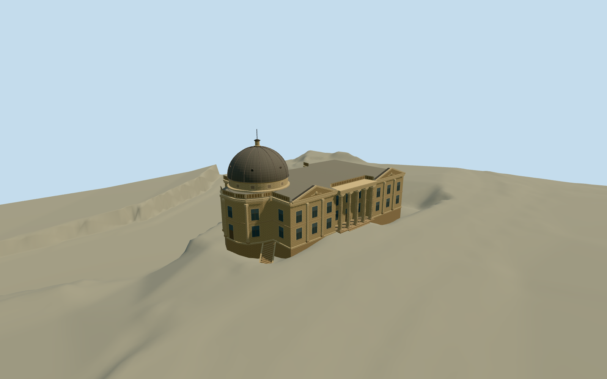

# Customs House, Brisbane

Customs House in Brisbane has a ribbed copper dome over the round Long Room, a stone Queen Street colonnade, and a lower storey on the Brisbane River side.

Authoring state: **review-in-qa.json**. Current completion evidence is in [qa.json](qa.json) and the [completion ledger](../../../../qualla-structures/batches/qualla-003.PROGRESS.md).

- [Customs House, Brisbane](https://qualla.com/customs-house-brisbane/)

The exterior follows the public-domain archival street view, mapped walls and written restoration record. Heights, window progression on less visible elevations, capitals and fine stone ornament are estimates.

The ongoing copper colour change after the 2024 replacement is represented by a muted transitional palette. Fine heritage inscriptions and exact railing ironwork are generalized.

Source Queensland Government terrain fixes the site slope. Landing and foundation positions are approximate. The adjoining river wall, precinct buildings and vegetation are outside scope.

Build: `node content/worldgen/source/places/r7/r7h/customs_house_brisbane/models/generate-customs-house-brisbane.mjs`. Add `--check` to verify exact regeneration. 12380 triangles; 6 materials; no embedded photographs.
