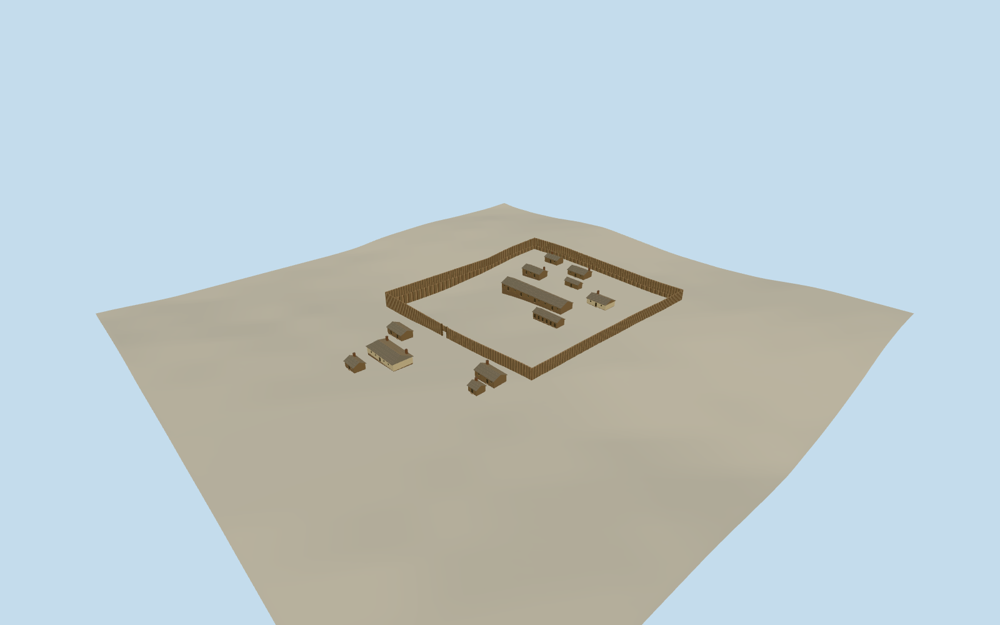

# Eagle Farm Women’s Prison and Factory (1838)

Eagle Farm’s late-1830s women’s prison and factory, with a double timber enclosure, long slab barracks, plain work buildings and the superintendent’s cottage.

Authoring state: **review-in-qa.json**. Current completion evidence is in [qa.json](qa.json) and the [completion ledger](../../../../qualla-structures/batches/qualla-003.PROGRESS.md).

- [Eagle Farm Women's Prison and Factory Site](https://qualla.com/eagle-farm-women-s-prison-and-factory-site/)

The present heritage markers approximate the historic building positions. Historic boundary registration, precise bay spacing, finishes and elevations are estimates.

Roof timber, openings, inner fence layout, detached service sections and individual terrain offsets are representative. Original ground is below later airport fill and is not reconstructed.

The model depicts the late 1830s establishment only. Modern memorial artworks, airport fabric, current interpretive buildings and archaeological displays are excluded.

Build: `node content/worldgen/source/places/r7/r7h/eagle_farm_women_s_prison_and_factory_site/models/generate-eagle-farm-womens-prison.mjs`. Add `--check` to verify exact regeneration. 25340 triangles; 5 materials; no embedded photographs.
