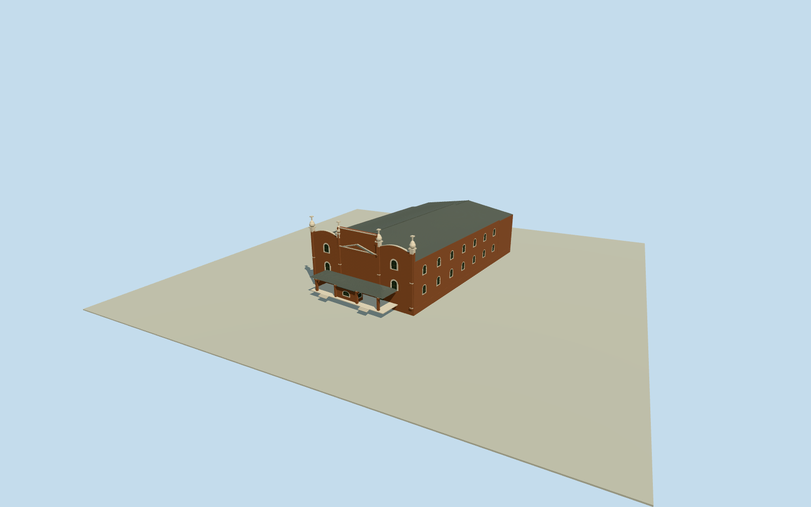

# Empire Theatre, Toowoomba (pre-fire1911–1933)

Complete original pre-fire1911–1933 Empire Theatre, with whole masonry auditorium/stage mass and closed main roof/side/rear walls, its original tall brick streetfront with white arched-window dressings/pilasters/curved parapet caps/onion finials, and intrinsic low hipped entry porch/ticket box. Exact Kemp photograph is dated only1911–1933;1922-01-01 is a representative midperiod convention. Do not substitute old front for the1933ArtDeco/current building. Current native footprint supplies site context only; primary heritage record says substantial1911side/front/rear walls survive in the1933rebuild. Historic envelope/roof/back sections are explicit bounded estimates. Exclude later1933flytower/foyer geometry unless proven pre-fire,1973shops/modernannexes/separate churchtheatre/estate/poles/trees/copied signs/crown/posters/people.

Authoring state: **review-in-qa.json**. Current completion evidence is in [qa.json](qa.json) and the [completion ledger](../../../../qualla-structures/batches/qualla-002.PROGRESS.md).

- [Empire Theatre, Toowoomba](https://qualla.com/empire-theatre-toowoomba/)

Exact current native EmpireTheatreway42341736/Q7731948/19controls supplies whole site context only, not surveyed1911footprint. Primary QHR600978 identifies same site/1911original and surviving side/front/rear walls, while current modern-annex/foyer/flytower extent differs. Historic registered full body/roof and rear geometry will be bounded estimates with±10m placement/bearing±10degrees; no exact historical survey required.

Exact historical envelope/hidden roof/stage/rear sections are bounded architectural estimates, not a current-state or measured1911plan claim. Retain complete original physical theatre, not facade-only.

Use only the exact already-cleared Kemp photograph; no current1933facade claim, copied lettering/crown/figures/posters/vegetation or questionable images.

Preserve original independent field/frame before all main dimensions/floors/sections/geometry; never flatten/reacquire/reframe or fit model main parameters to renders.

Complete original estimated36m-wide auditorium/stage body, with original streetfront registered behind later1933foyer. Exact old extent/roof/stage/back sections not surveyed; no90ft1933flytower/modernannex/1973shop transfer.

Four ornate finials/curved parapets/pilasters/white arched dressings/low entry canopy and ticketbox are photo-led; hidden corresponding rear details and precise ornament are simplified estimates. Exclude sign lettering/crown art/posters/telephone poles/people/trees.

Current DEM can obscure lower walls/entry at this historic registration. No claim of exact historic contact and no terrain cutout/site pad/flattening/reacquisition/main-parameter fitting.

Build: `node content/worldgen/source/places/r7/r7h/empire_theatre_toowoomba/models/generate-house.mjs`. Add `--check` to verify exact regeneration. 16921 triangles; 6 materials; no embedded photographs.
