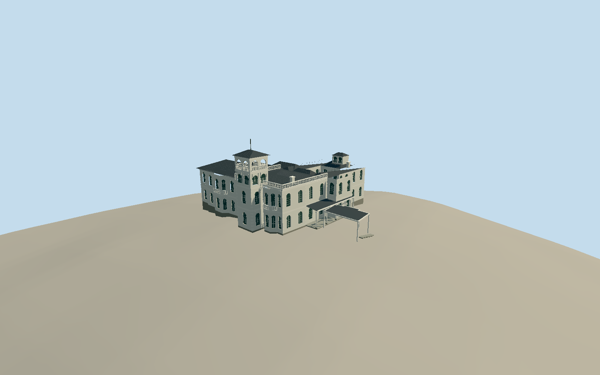

# Government House, Brisbane

Whole connected Government House/Fernberg mansion exterior:1888 north Italianate reception block/faceted bays/square open-loggia tower, original1865 southern guest wing/raised slate hip and paired-arch clerestory, connected1937 eastern wing, surviving verandahs/balconies/semicircular piazza ends, bounded1950 western covered connection/porte cochere and rear court. Exclude separate estate residences/administration cottage/garages/guardhouse, grounds/gates/fountain/pool/vegetation, interiors, exact stained-glass figures/crests and flags.

Authoring state: **review-in-qa.json**. Current completion evidence is in [qa.json](qa.json) and the [completion ledger](../../../../qualla-structures/batches/qualla-002.PROGRESS.md).

- [Government House, Brisbane](https://qualla.com/government-house-brisbane/)

Actual named GovernmentHouse way541465821/Q494360 (BrisbaneCityCouncil source2018, current native version2025) supplies whole connected41-corner footprint; north tower projection supplies local bearing. +X east-southeast along north front; +Z south-southwest toward original wing. Historic government plans establish rear courtyard/balcony topology; footprint has no interior ring, so exact current court boundary/covering cannot be certified. Current2022 creatorCC0 exterior and2005 named creatorPD exterior establish surviving volume/white Italianate finish; detailed heights/court/roof joins remain bounded estimates.

Fixed northwest exterior contact source datum63.8869m, north court near+0.113m and eastern/southern perimeter down to-2.403m. Main finished floor+0.45m and basement foundation down to-2.8m are architectural estimates chosen before geometry, exposing a bounded basement on the downhill side. Original terrain16641values/raw tile/PNG fixed unchanged, no flattening/roof-fitting/reacquisition. Exact basement/terrace contacts not surveyed, geographic preview/replacementfalse.

Whole connected native mansion perimeter, with original southern wing/1888 north reception block and prominent square tower/1937 east wing/integral western covered connection. Separate estate buildings, grounds/gates/statues/fountain/pool/vegetation, interiors, flags and figured crests/stained-glass imagery excluded.

Four exact cleared published exterior originals (Figaro2005 named public-domain release and McPherson2022 ownCC0), plus two exact native circa1940 QueenslandStateArchives government architectural drawings/explicit PD-AustraliaGov grant. Missing local plan-category evidence is bound independently to exact native archive items without changing article/media metadata. No generated bitmap, doubtful photograph, licensed pixel or borrowed mesh.

White stucco/quoins/cornice/balustraded parapet, faceted bays/awning balcony ends, segmental sash openings, genuine open upper tower loggia and veranda/porte-cochere supports; six actual canonical slots/five shared graphs. Slate roof topology/fine pitches, exact sash/baluster/vent census and hidden facade details are bounded medium-fi interpretations, not measured survey.

Historic plans establish an open rear court, retained instead of inventing a solid roof across it. Current mapped perimeter has no court ring; exact current inner court dimensions/later covering/roof joins remain unverified. Roof strips and raised paired-arched guest-wing clerestory follow photographs and historical topology with estimated dimensions.

Fixed independent16641value field/raw tile/heightPNG frozen before geometry and unchanged. Floor/basement contacts estimated, geographic preview only/replacementfalse; no flattening/fitting of source terrain or certified construction contact. Full architecture/four LODs/current material/context/native-outline views reviewed in same pass.

Build: `node packages/worldgen/scripts/generate-authored-places.mjs --ids=government_house_brisbane`. Add `--check` to verify exact regeneration. 22147 triangles; 6 materials; no embedded photographs.
