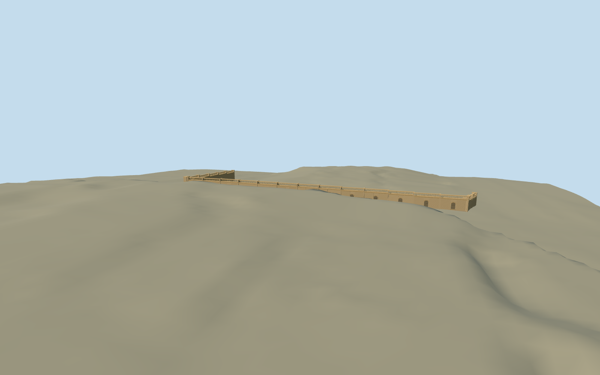

# Holy Name Cathedral Site, Brisbane

The surviving Ann and Gotha Street sandstone walls, with round-headed recesses, square piers and continuous carved stone balustrades.

Authoring state: **review-in-qa.json**. Current completion evidence is in [qa.json](qa.json) and the [completion ledger](../../../../qualla-structures/batches/qualla-003.PROGRESS.md).

- [Holy Name Cathedral, Brisbane](https://qualla.com/holy-name-cathedral-brisbane/)

The state register controls the scope and real wall strip. The centerline is inferred within that official strip from the two street-facing edges.

The original 1928 CC0 photograph establishes the wall fabric, round recesses, balustrades and masonry piers. Bay count, current infills, wall height and the details of the short return are estimates.

The standing Ann and Gotha Street wall fabric is shown. The modern apartments are outside the physical scope of this site model.

Build: `node content/worldgen/source/places/r7/r7h/holy_name_cathedral_brisbane/models/generate-holy-name-cathedral-brisbane.mjs`. Add `--check` to verify exact regeneration. 40842 triangles; 4 materials; no embedded photographs.
