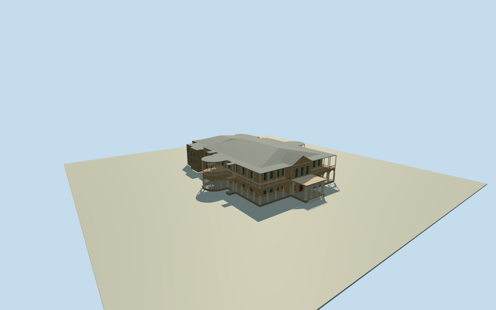

# Old Government House, Brisbane

Gardens Point sandstone residence with an open carriage portico, long arched verandas, curved garden pavilions, and a rear service range.

Authoring state: **review-in-qa.json**. Current completion evidence is in [qa.json](qa.json) and the [completion ledger](../../../../qualla-structures/batches/qualla-003.PROGRESS.md).

- [Old Government House, Brisbane](https://qualla.com/old-government-house-brisbane/)

Two exact public-domain Qualla originals document the early color appearance, published in September 2005. Their exposure dates are unknown. The stone entrance porch, pediment, arched lower verandas and upper railings follow the photographs.

The native perimeter anchors the stepped rear service range, covered verandas and two curved wings. Roof arrangement, individual openings, covered courtyard, and height sections are proportional estimates.

The 128 m original terrain remains unchanged. The field and porch datum guide foundation and stair levels. The separate campus buildings and grounds are outside this asset.

The model uses original geometry and procedural surfaces. No source photograph pixels are included.

Build: `node content/worldgen/source/places/r7/r7h/old_government_house_brisbane/models/generate-house.mjs`. Add `--check` to verify exact regeneration. 9509 triangles; 6 materials; no embedded photographs.
