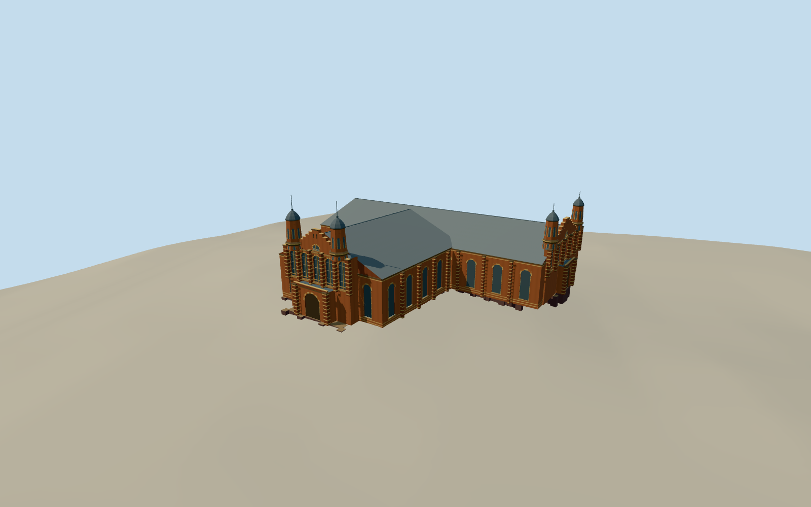

# Old Museum Building, Brisbane

The T-shaped Old Museum with two hall roofs, ornate red and cream brick façades, paired domed tower entrances and the exposed glazed-brick basement.

Authoring state: **review-in-qa.json**. Current completion evidence is in [qa.json](qa.json) and the [completion ledger](../../../../qualla-structures/batches/qualla-003.PROGRESS.md).

- [Old Museum Building, Brisbane](https://qualla.com/old-museum-building-brisbane/)

The mapped building and both entrance compositions set the physical scope. The 2019 photograph documents the Concert Hall front and the 2011 photograph supplies surviving tower details.

Rear openings, fine ornament, tower height and roofs use estimates from the visible reference evidence and written survey.

The original relief remains unchanged. The basement contact follows the approximate local terrain.

Build: `node content/worldgen/source/places/r7/r7h/old_museum_building_brisbane/models/generate-brisbane-old-museum.mjs`. Add `--check` to verify exact regeneration. 14708 triangles; 6 materials; no embedded photographs.
