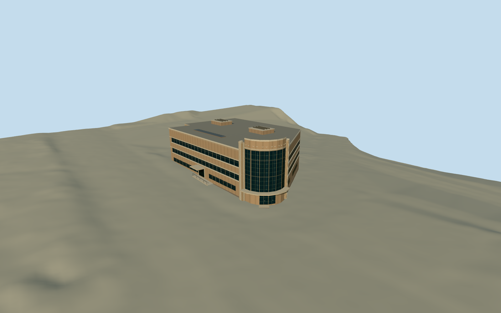

# Queensland Brewery Company Building

The former Queensland Brewery headquarters at 501 Ann Street, with a curved glazed corner turret, angular piers, buff brick and two long bands of ribbon windows.

Authoring state: **review-in-qa.json**. Current completion evidence is in [qa.json](qa.json) and the [completion ledger](../../../../qualla-structures/batches/qualla-003.PROGRESS.md).

- [Queensland Brewery Company Building](https://qualla.com/queensland-brewery-company-building/)

The ground registration and plan follow original government elevations and the mapped building envelope. Floor, parapet and tower heights are estimates.

The contemporary description and public-domain photograph establish persistent heritage fabric. Current glass, secondary window details, exterior fittings and roof equipment are approximate.

The principal building is represented. The new school footbridge, other campus buildings and interiors are outside the model scope.

Build: `node content/worldgen/source/places/r7/r7h/queensland_brewery_company_building/models/generate-queensland-brewery-company-building.mjs`. Add `--check` to verify exact regeneration. 1704 triangles; 5 materials; no embedded photographs.
