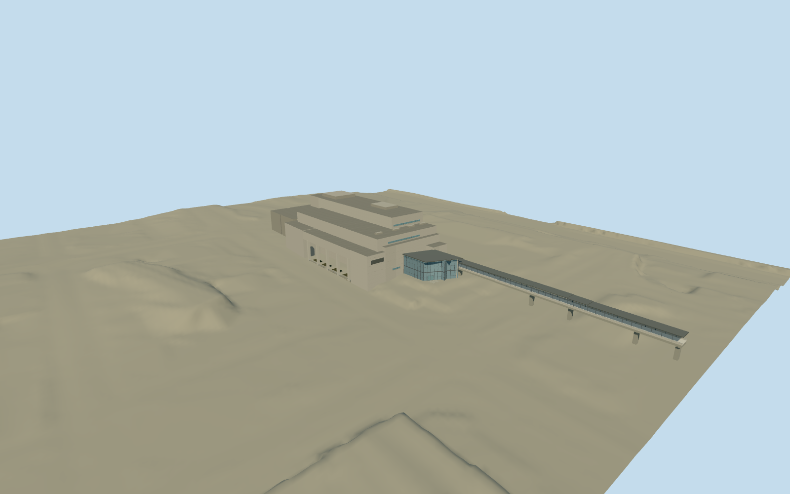

# Queensland Museum Kurilpa

Robin Gibson’s stepped concrete museum and open Grey Street garden, with its glazed Melbourne Street entrance and attached covered overpass.

Authoring state: **review-in-qa.json**. Current completion evidence is in [qa.json](qa.json) and the [completion ledger](../../../../qualla-structures/batches/qualla-003.PROGRESS.md).

- [Queensland Museum](https://qualla.com/queensland-museum/)

The standing museum perimeter, main entrance point and bridge alignment are mapped. Upper setbacks, roof screens, planters, joints and service openings are proportioned from exterior and written evidence.

The conservation report establishes the full-height indoor-outdoor Museum Garden at Grey Street. Its bay divisions, planting and opening extents are estimates.

The glazed Melbourne Street entrance uses the surviving building form and an exact public-domain 2005 photograph. Reworked threshold, fascia details and the walk deck section are approximate.

The original Queensland Government elevation field is unmodified. The placement uses the Melbourne Street sidewalk datum and retains approximate contact across its different pedestrian levels.

Build: `node content/worldgen/source/places/r7/r7h/queensland_museum/models/generate-queensland-museum.mjs`. Add `--check` to verify exact regeneration. 3752 triangles; 5 materials; no embedded photographs.
