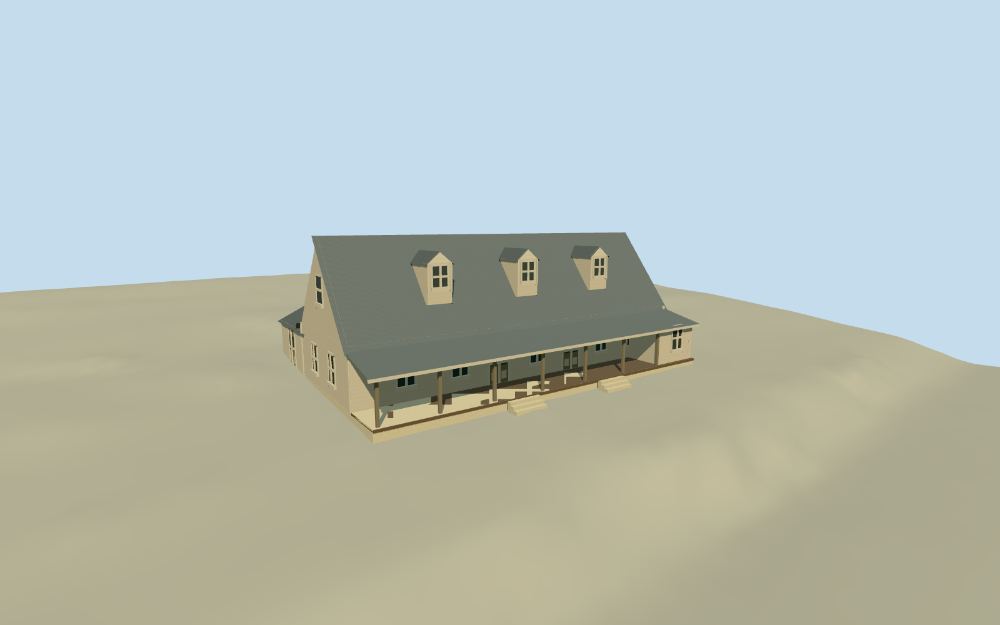

# Royal Bull's Head Inn

The timber Royal Bull’s Head Inn on Brisbane Street in Drayton, with steep corrugated iron roofs, four dormers and a long street verandah.

Authoring state: **review-in-qa.json**. Current completion evidence is in [qa.json](qa.json) and the [completion ledger](../../../../qualla-structures/batches/qualla-004.PROGRESS.md).

- [Royal Bull's Head Inn](https://qualla.com/royal-bull-s-head-inn/)

The standing inn and its small rear kitchen return are represented. Detached former stables, ancillary structures and the demolished earlier inn are outside this source.

Roof pitch, paint colors, rear dormer and door placement, enclosure position and joinery detail are estimated from monochrome photographs and written records.

Build: `node content/worldgen/source/places/r7/r7h/royal_bull_s_head_inn/models/generate-royal-bull-s-head-inn.mjs`. Add `--check` to verify exact regeneration. 2310 triangles; 5 materials; no embedded photographs.
