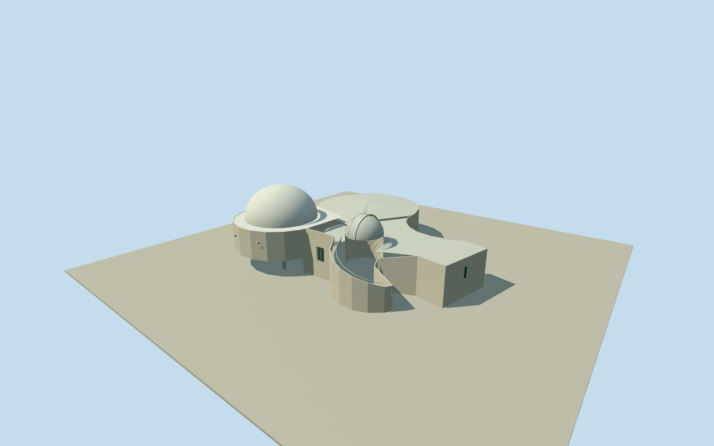

# Sir Thomas Brisbane Planetarium

Whole native multilobed planetarium: white main Cosmic Skydome/curved fluted auditorium/cantilevered underside and supports, smaller cylindrical telescope observatory/ribbed dome/raised shutter, eastern low-roof foyer and native service jags, open sweeping access ramp and own stairs, real entry/vents. Native51-vertex boundary and mapped entrance; no site pad or garden/statue/parking/interior.

Authoring state: **review-in-qa.json**. Current completion evidence is in [qa.json](qa.json) and the [completion ledger](../../../../qualla-structures/batches/qualla-002.PROGRESS.md).

- [Sir Thomas Brisbane Planetarium](https://qualla.com/sir-thomas-brisbane-planetarium/)

Original named Sir Thomas Brisbane Planetarium building way37025041/Q1444706 retains all51 nonduplicate vertices and node IDs, no smoothed/replaced compound footprint. Original entrance node469535518 is boundary vertex8. Actual straight entry wall7to9 defines westward outward normal/heading-1.62936205176055rad; full original vertex-mean anchor[152.97692078235295,-27.47571355490196]. Native NW auditorium arc10..23, eastern curved wing25..38, SW spiral-access/observatory region0..7/48..50 and full southern service-jog vertices39..47 retained. Component roof partitions/circular continuations and observatory centre are photographic estimates, not separately mapped building parts; do not fill the open spiral access area with a solid observatory cylinder or invent a site slab. Fixed exterior entry approach[1.8233977585460464,12.141578029876964]three metres beyond mapped door before terrain/geometry. Door/floor0, own undercroft/supports near-3.2m and all ramp grades are bounded source-photo estimates, not surveyed levels. Neighbor Information/Visitor Centre buildings, gardens, statue, parking and roads excluded.

Whole native51-vertex multilobed exterior and mapped entrance retained. Main broad dome/curved auditorium is NW, lower foyer is east, smaller telescope observatory and open spiral access occupy SW region; full native southern service jags retained. Internal partition/roof centres and small observatory centre[8.4,5.3] are photo estimates inside the original outline, not separately mapped building parts. No whole-site floor/pad, gardens/statues/parking/cars/fences/lamps/sign text, visitor neighbours, sundial or interior/exhibits.

Three exact already-published Figaro2008 public-domain originals inspected; native SHA1/named own photographer/PD-self matched. Seven source families inventoried; attribution images unused. No supplemental photographs, copied pixels or generated bitmap. Main white hemisphere, vertically fluted curved walls/cantilevered underside, smaller ribbed telescope dome/raised shutter, low pale foyer roof and sweeping curved access walls follow the retained views.

Approximate exterior heights, roof partitions/ridge locations, rear details, shutter closed state and seam count, curved ramp grade/step census, underside/core/support positions and finish after2008 are accepted medium-fi estimates. Main Cosmic Skydome12.5m is the internal theatre diameter, not the full external auditorium width. Exterior dome base6.8m radius/top11.5m, small telescope dome3.2m radius/eave5.5m, common entry floor0/own underside near-3.2m are visualization controls.

Independent128m129x129at1m field/raw source tile/grid/PNG frozen before model. Fixed entry approach[1.8233977585460464,12.141578029876964], provider41.0421m and full relative field[-6.0421,4.6758] unchanged without fitting or flattening. Own building floors/foundations and ramp are structure geometry, not a site pad; exact threshold/host terrain contact and floor survey remain unverified. Geographic preview/replaceFootprint=false; flat review ground-3.25 exposes the actual model underside.

Build: `node packages/worldgen/scripts/generate-authored-places.mjs --ids=sir_thomas_brisbane_planetarium`. Add `--check` to verify exact regeneration. 12976 triangles; 6 materials; no embedded photographs.
