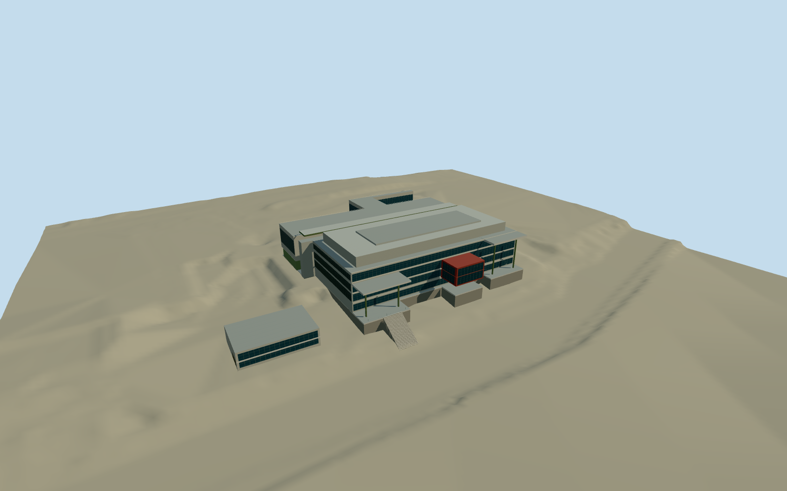

# State Library of Queensland

State Library of Queensland on Brisbane’s South Bank, with its open Knowledge Walk, projecting Red Box reading room, river decks and separate Edge building.

Authoring state: **review-in-qa.json**. Current completion evidence is in [qa.json](qa.json) and the [completion ledger](../../../../qualla-structures/batches/qualla-003.PROGRESS.md).

- [State Library of Queensland](https://qualla.com/state-library-of-queensland/)

The current map fixes the site plan. Roof setbacks, blade rhythm, floor heights, terrace stairs, window details and exact finishes are architectural estimates.

The unchanged Queensland Government elevation raster establishes site grade. Discrete floor and threshold elevations are approximate.

The sole CC0 image in the published Qualla set shows an indoor workshop. The standing exterior was built from written architectural facts and native geometry with no adopted reference imagery.

Build: `node content/worldgen/source/places/r7/r7h/state_library_of_queensland/models/generate-state-library-of-queensland.mjs`. Add `--check` to verify exact regeneration. 2950 triangles; 5 materials; no embedded photographs.
