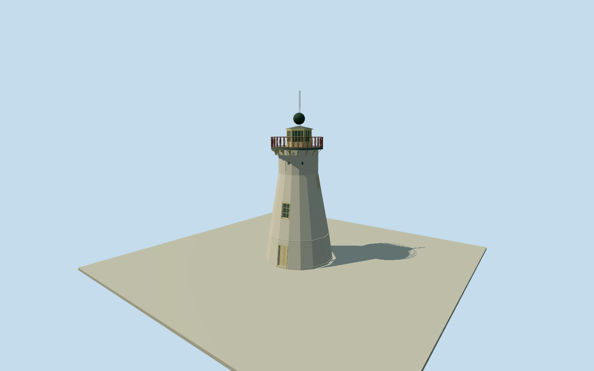

# The Old Windmill, Brisbane

Surviving rendered tapered windmill/signal tower on its full native base; real casement and entrance recesses/drip moulds, six framed upper apertures, circular cantilevered balcony/timber corbels/open loop iron railing, offset hexagonal glazed cabin/low metal roof, patinated copper time ball and mast. No historical sails, treadmill or neighboring park structures.

Authoring state: **review-in-qa.json**. Current completion evidence is in [qa.json](qa.json) and the [completion ledger](../../../../qualla-structures/batches/qualla-002.PROGRESS.md).

- [The Old Windmill, Brisbane](https://qualla.com/the-old-windmill-brisbane/)

Original named Old Windmill way1384456307 retains all14 nonduplicate node positions. Anchor is exact original vertex mean[153.0230686,-27.465744678571426]. Nearby Wickham Terrace way9628273 fixes northward street relationship; chosen street-facing visualization heading3.1165965808316516rad is approximate, not a measured doorway azimuth. Native base remains unsimplified; upper taper and architectural heights derive from photographs/text, not map survey. Fixed street-side approach[0,6.4] before terrain and geometry; exact floors/steps/host terrain contact unverified.

Complete surviving masonry tower and signal-station crown only. Full native14-vertex base retained; upper taper, minor panel dimensions and hidden aperture positions are estimates. No lost sails/treadmill, demolished cottages, reconstructed flagstaff/site wall/archway, reservoir roofs, nearby hotel, roads, cars, trees or interior.

Two exact already-published Figaro2005 public-domain originals only, native SHA1/photographer and PD-user-en grant matched;28 source families inventoried. Historical/unknown-author/attribution/unrelated images unused, no supplemental photos/copied pixels/generated bitmap. Architectural text only supplies approximate16m roof height excluding ball/mast,8.4m base/4.5m top and five casements/six small upper windows/hexagonal offset cabin.

Pale rendered mock ashlar masonry/reefing lip, closed double door and casements, small recessed upper lights, cantilevered platform/carved timber corbels/open red-brown iron loop railing, offset pale glazed cabin/chamferboards/metal hip roof and copper time ball/mast retained. Exact finish after2005, aperture angles, small roof facets, cabin offset, iron/corbel census, time-ball raised state and height are bounded exterior estimates; no surveyed interiors.

Chosen street-facing entrance is an approximate visualization bearing, angular uncertainty60degrees, not a measured doorway azimuth. Original native tower/street positions remain. Fixed north/street-side approach[0,6.4] before independent64m129x129at0.5m field; provider59.8753m, full relative field[-12.3966,3.0033] retained without flattening/fitting. Exact host ground contact, threshold, steps and floors unverified; geographicpreview/replaceFootprint=false.

Build: `node packages/worldgen/scripts/generate-authored-places.mjs --ids=the_old_windmill_brisbane`. Add `--check` to verify exact regeneration. 9540 triangles; 7 materials; no embedded photographs.
