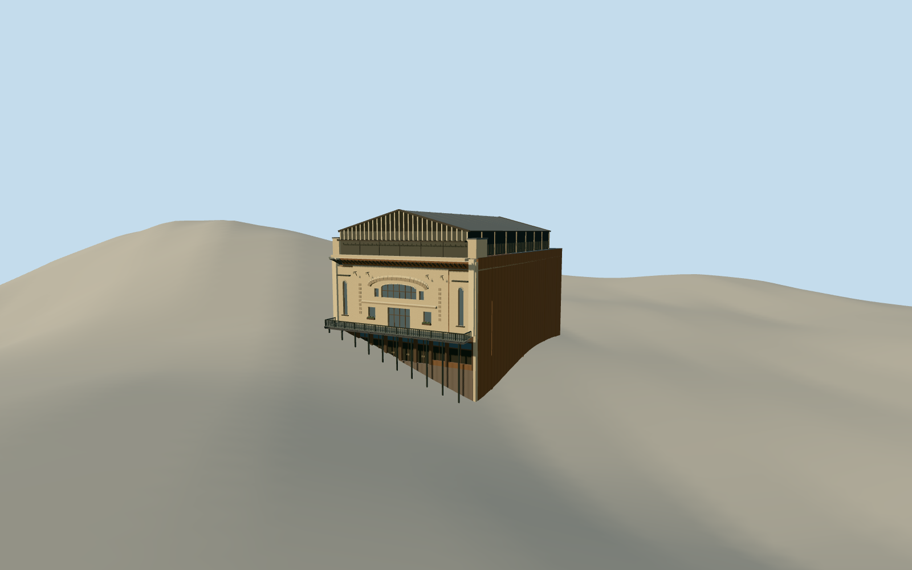

# Tivoli Theatre, Brisbane

The original Albert Street Tivoli Theatre in Brisbane, with its dramatic sheet-metal cornice, balcony terrace and gabled rooftop vaudeville theatre.

Authoring state: **review-in-qa.json**. Current completion evidence is in [qa.json](qa.json) and the [completion ledger](../../../../qualla-structures/batches/qualla-003.PROGRESS.md).

- [Tivoli Theatre, Brisbane](https://qualla.com/tivoli-theatre-brisbane/)

The former footprint is reconstructed from the original Albert Street alignment, the story pin, the 1918 photograph and known theatre capacity. The exact lot line, hidden rear and side arrangements, depth and height are estimates.

The cleared 1918 photograph is monochrome. Exterior colors are period-material estimates. The original site has been regraded as King George Square, so historical threshold and sidewalk levels are approximate.

Historical placement covers the documented pre-1927 exterior. The current Fortitude Valley theatre and the surrounding square are outside this model.

Build: `node content/worldgen/source/places/r7/r7h/tivoli_theatre_brisbane/models/generate-tivoli-theatre-brisbane.mjs`. Add `--check` to verify exact regeneration. 8254 triangles; 6 materials; no embedded photographs.
