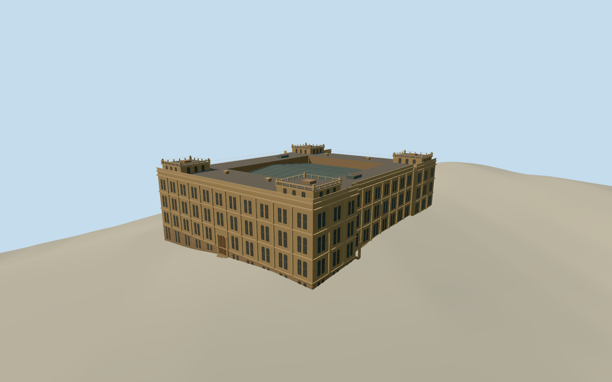

# Treasury Building, Brisbane

The former Treasury Building as it stood in 2005, with four sandstone frontages, regular paired sash, deep cornices, raised corner pavilions and a covered courtyard.

Authoring state: **review-in-qa.json**. Current completion evidence is in [qa.json](qa.json) and the [completion ledger](../../../../qualla-structures/batches/qualla-003.PROGRESS.md).

- [Treasury Building, Brisbane](https://qualla.com/treasury-building-brisbane/)

The model represents the completed former Treasury Building in 2005. Original eastern and northern masonry details, covered courtyard geometry, ornament and roof fixtures are approximate. Temporary signs and the neighboring Land Administration Building are excluded.

The original terrain remains unchanged. The four street grades are sampled from a composite model, which can include modern surface features. The entry stairs and vertical registration are approximate.

Build: `node content/worldgen/source/places/r7/r7h/treasury_building_brisbane/models/generate-brisbane-treasury.mjs`. Add `--check` to verify exact regeneration. 12004 triangles; 4 materials; no embedded photographs.
