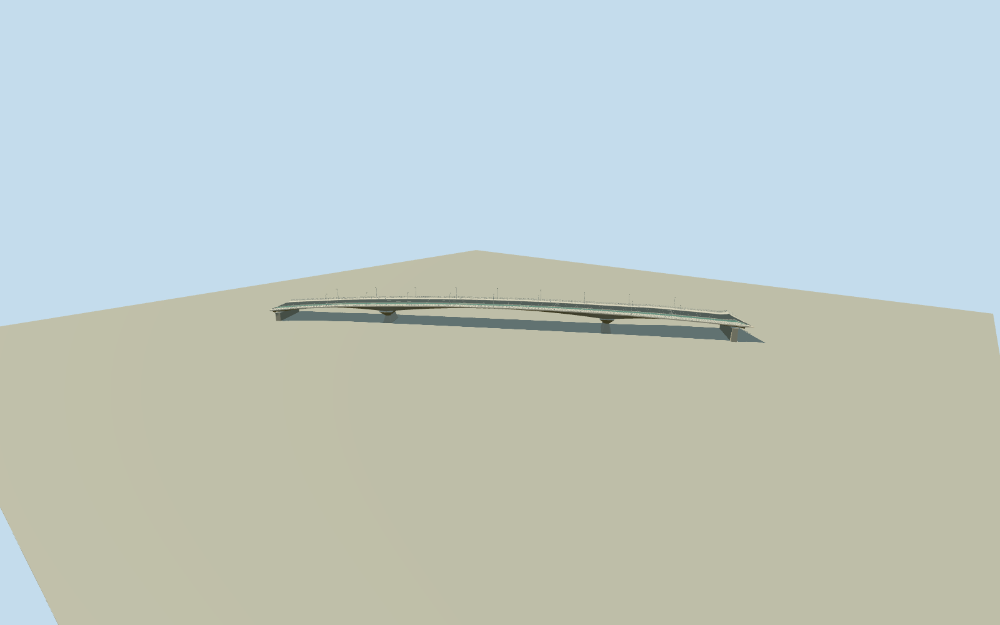

# Victoria Bridge, Brisbane

Whole current1969Victoria Bridge on exact34-control deck/approach outline: long cambered concrete deck/integral flares, closed tapered haunched box-girder exterior/three structural spans/two original photo-estimated flared bladepiers/modern endabutments, true open physical edge rails/kerbs/light standards and original simplified3buslane/bidirectionalcyclepath/widerwalk surfacing. Two cleared published2009creatorPD Qualla originals first/only imagery; current use corroborated by Council/structuralengineer factual text. Primary313m nominal core retained within longer native integral approaches. Exact deck/pier sections/hiddenfoundations/postrefurbbarriers/finish/currentlayout original estimates. Original sourcefield retained including invalid riverbed outliers, contactunverified/preview.

Authoring state: **review-in-qa.json**. Current completion evidence is in [qa.json](qa.json) and the [completion ledger](../../../../qualla-structures/batches/qualla-002.PROGRESS.md).

- [Victoria Bridge, Brisbane](https://qualla.com/victoria-bridge-brisbane/)

Whole exact closed35point/34unique native deck/approach footprint483669189/Q7926597. Fixed nativebboxanchor/heading0/+Xeast+Zsouth chosen before independentterrain/floors/deck levels/haunch/pier sections/geometry. All34 real boundarycontrols retained, no invented native centreline/pier polygon. Two nearby taggedpierways belong elsewhere, omitted. Raw arch type tag disagrees with acceptedphoto/primaryengineeringboxgirder description; raw evidence retained unchanged, model follows actual concrete haunches.

Independent original600m129x12916641sample/one rawtile/fixedSW14.1746m provider-relative datum frozen before every floor/deck/haunch/pier/profile/geometry choice. Once-only native end-midpoint samples7.0174m(SW)/9.796m(NE) selected BEFORE geometry, floor-7.1572m and NErise2.7786m fixed once; original6.2mparaboliccamber/.012crossfall/slab.55m chosen from accepted photo proportions, not after renders. Full34-control native deck and integral approachflares retained in originalframe, no outline simplification or invented nativepier controls. Primary313m nominal core/1969haunched posttensioned precastboxgirder; originalcore5-318m/two piers84.5/238.5m, girder1.05m midspan/4.35m atpiers, flaredpierhead9.6x21.6m/neck3.5x12.8/base6.4x15.2m/basey-8, unsurveyed foundations/abutments. CurrentCouncil3buslanes/bidirectionalcyclepath/widerwalks represented by original normalized surfacebands; exact postrefurbishment barriers/lanemarkings/lights/census/finish/deck grade/hiddenutilities/riverbed unknown. Raw sourcefield has extreme negative samples-437.4038m, not surveyed bathymetry or constructiongrade. Preserve originalbytes/no fit/flatten/reacquire/reframe/floorretune/modelraise; sourcecontact unresolved, geographicpreview/replaceFootprintfalse. No historictruss/oldabutment/adjacentbridges/station/boats/city/copiedpixels.

Exact cleared published2009Figaro ownPD-self structural-side and Fairfieldstation own/all-rights-waived/PD-self elevatedapproach originals individually inspected/nativeSHA1matched; unchanged published guard passed. Entropyview-away/oldtruss/uncertainhistoricals excluded; no supplementals/source-or-rightsrepair/policychange/samephotobypass/copiedpixels. Original shell/camber/haunch/piers supported by these photographs; current3buslanes/bicyclepath/walks factual, exactcurrentsmallbarriers/lights/paint and hiddenunderside/footings original estimates. No operationalclearance/loadcapacity/bathymetry/survey/currenttrafficlayout certification. Oldabutment/adjacentbridges/station/vehicles/city/river/temporarywork/art/signs excluded.

Original independent600m129field/one rawtile/SW14.1746m provider-relative datum frozen before floor/deck/haunch/pier choices. Once-only nativeSW7.0174/NE9.796m samples/floor-7.1572m/NErise2.7786/camber6.2m all chosen BEFORE geometry. Field includes extreme negative urban/river samples-437.4038m; not accepted as surveyedbed/waterline/foundation. No terrainfit/flatten/reacquire/reframe/retunedendlevels/modelraise. Geographic preview/replaceFootprintfalse/exactgradecontactunresolved. Flatground/syntheticneighbors are reviewfixtures.

Build: `node content/worldgen/source/places/r7/r7h/victoria_bridge_brisbane/models/generate-victoria-bridge-brisbane.mjs`. Add `--check` to verify exact regeneration. 35630 triangles; 3 materials; no embedded photographs.
