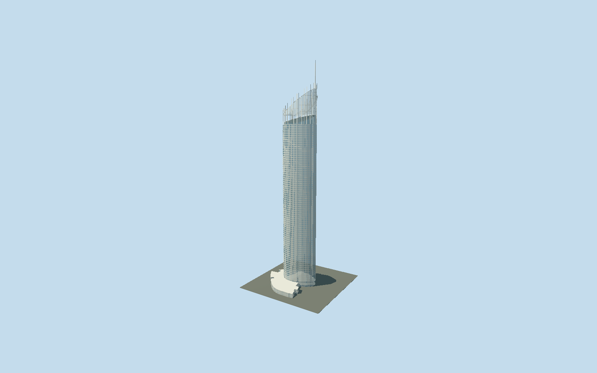

# Q1 Tower

Complete asymmetric blue/white Q1 apartment tower and mapped podium, projecting rear balconies/courtyard canopy, glazed observation ceiling, open steel/glass sail, northern climb and322.5m mast.

## Evidence and reconstruction

Published dimensions and reconstructed details are separated in spec.json. Primary references:

- [Reference](https://dxp1416ihlpln.cloudfront.net/s3fs-public/2019-07/2015-Project-Bulletin-Q1-Low-Res.pdf)
- [Reference](https://www.skypoint.com.au/about-us)
- [Reference](https://www.skypoint.com.au/climb)
- [Reference](https://www.q1.com.au/)
- [Reference](https://www.openstreetmap.org/way/188325694)

No third-party geometry, photograph or bitmap texture is embedded. Shared surface graphs come from the central library; vertex tints carry model colors. Glazing uses PBR materials; transparent surfaces are declared per model.

## Model and axes

29,461 triangles; 82,157 vertices; 4 material groups; 3,313,992 bytes. Native bounds: -51.785, 0.000, -30.139 to 23.900, 322.500, 50.902. Source hash: `sha256:43e080d45a9ffecc5c4c81573a0e4219d0b92360f21a361a8d78f1835ee9f5de`.

{"up":"+Y","longitudinal":"+X east/southeast toward pointed Pacific-facing end","front":"+Z south/southwest; exact entrance unverified","origin":"Ground-contact mapped tower frame center"}

The geographic proposal uses exact-QID OpenStreetMap evidence. Map-derived orientation and estimated architectural details require real-site visual review; preview eligibility is distinct from geographic/fidelity approval. Map attribution: © OpenStreetMap contributors, ODbL-1.0.

## Reproduce

Run `node packages/worldgen/scripts/generate-signature-towers.mjs --ids=q1_tower` (or add `--check`). The generator preserves manually edited masters by checking their baseline hashes. Import through the standard authored-model workflow with optimization disabled; then capture all QA cameras, including shared-surface views.

## Pending work

- Complete medium-fi tower/podium bundle retains asymmetric mapped apartment shaft, white floor bands, blue glazing, projecting rear balconies, glazed observation ceiling, open sloping crown sail/ribs, exposed northern climb and322.5m offset mast. Original106501-triangle detailed recipe remains unchanged and reproducible. Orrcon supplies322.5m total/90m crown assembly and curved pipe/RHS construction. Operator describes level77 observation230m, launch240m above street and summit270m above sea level; model uses nominal240/270m geometry and does not claim those published datums are identical. Apartment floors, reconstructed232.5m shaft top, sloping234.5–245m observation ceiling,245–279m sail outline, ribs, mast offset and stair bends are photo-informed approximations, not surveyed elevations. Orrcon historical80-storey wording differs from map78; facade rhythm is reconstructed without a literal floor-count assertion. Owner photographs show pool-side projecting canopy and white/blue facade; canopy geometry/position approximated on rear courtyard sector. Ground entrance locations, hotel rooms, landscaping, separate pool surfaces, surrounding villas and basement omitted. Independent two-storey podium remains modeled. Shared painted metal, concrete and stone graphs with component tint; opaque facade PBR and alpha ceiling/crown glazing; no source photos copied as textures. Tiny balcony balusters and repeated mullions simplify by level. Actual grade, night lights and physical-device timings remain unmeasured.

This bundle follows the medium-fi standard. Medium-fi appearance and geographic fit are reviewed separately. Hash-bound visual acceptance is recorded separately after capture inspection.
