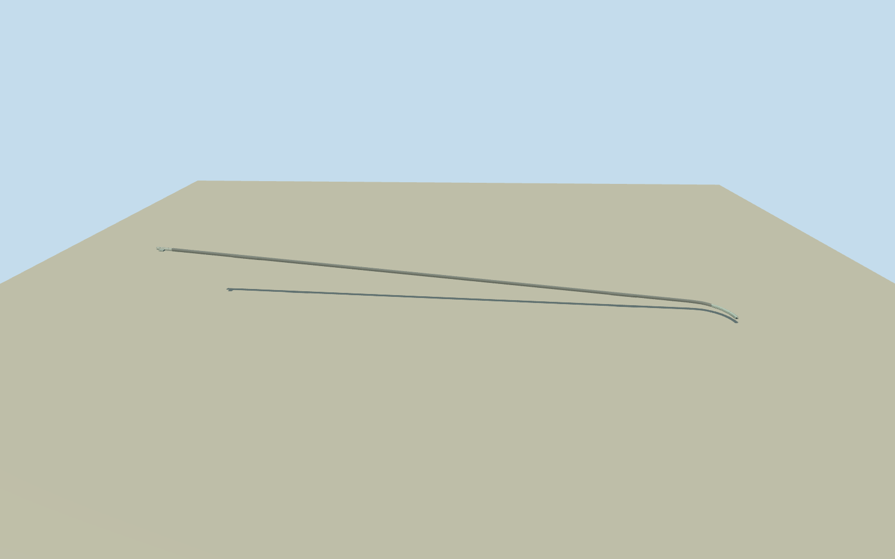

# Homer Tunnel (2016)

Complete representative2016Homer Tunnel along original nine-point route and both covered approaches. Truly open granite road bore/descending1:10grade/two mapped passing bays, old eastern faceted concrete shelter and own annex, full curved western gabled roof gallery with open frames/one clad side. Both actual opposite portal positions and original western envelope retained. Historical-only2016because east shelter replaced2024. No mountain/site slab/road network/vehicles/signs/people or new protected artwork; hidden sections and precise historic grade/contact estimated.

Authoring state: **review-in-qa.json**. Current completion evidence is in [qa.json](qa.json) and the [completion ledger](../../../../qualla-structures/batches/qualla-002.PROGRESS.md).

- [Homer Tunnel](https://qualla.com/homer-tunnel/)

Full original nine-point named Homer Tunnel road24765236onSH94, actual bend and passing-place nodes, covered east approach1313398979and curved west gallery1021888401, plus original native tunnel/shelter envelopes. Eastern node9291822178anchors assembly; +Xroughlywest along tunnel, +Zroughlynorth. Native named-road length1227.367491mkept without stretching to nominal1240/1270mpublic descriptions, which use different extents. Primary EngineeringNZ gives1:10descent east-to-west; that grade controls a declared estimated continuous road profile, NOT terrain fitted to a bore. Full mapped road and both covered approaches retained, with genuinely open bore/portal/gallery. Cleared2007east and2016west photos depict pre2024east shelter; NZTAconfirms its replacement mid2024. Historical-only representative2016appearance, not default current placement. Native mapped positions/envelopes are modern registration controls, not certified2016corners; east annex/portal depths/hidden sections/current excavation and precise historic contact remain estimates. Fixed eastern approach before terrain/geometry.

Historical-only representative2016, valid2016-01-01through2017-01-01dated opt-in. Old eastern shelter was replaced mid2024, as confirmed by NZTAtext; new current shelter/iwi artwork not claimed or used. Native modern position/envelope data register2016geometry; not an exact historic survey. Both full portals/covered approaches/continuous bore retained, rather than an isolated generic mouth.

Two exact published public-domain Qualla originals inspected: east550x413Mikedux/photo2007/nativeSHA1102d557fc930eca9b93f86241c112a091c2f0138and west4637x2982Szilas2016/nativeSHA1e820be0076a35f3dea59de6902595fb83dfaa732. Native PD-user-en/ownphoto-PD-self releases pinned; full41source families inventoried without conflicts. All other imagery excluded. Primary engineer/operator facts are text only; no external photo/diagram/copied pixels/generated bitmap.

Native route1227.367491mplus33.876684meast cover/61.345057mcurved west gallery kept at original scale, without stretching to varying nominal1240/1270mmeasurements. Primary1:10grade gives estimated boreeastfloor-3.887604m/finalwestgallery-132.758859mrelative to fixed east approach. Bore6mminimum width/5.3mcrown, east faceted arch4.65mcrown/west gable5.9m, passing-bay width/side/tapers, equipment annex/hidden lining/frame/roof/cable census and exact original floor/cross-sections remain estimates. No traffic furniture/copied signs/whole cliff or topographic mountain added.

Independent3072m129x129at24mfield/16641samples from25original Terrarium tiles, frozen before geometry at fixed eastern approach. Provider921.0921m/whole relative[-208.5507,1153.1756]m; raw tiles/grid/PNG unchanged without road fitting/clipping/flattening.3.3919moutput pixels may oversample coarser DEM;24mgrid cannot resolve portals or historic road level. Underground bore requires compatible host excavation; default terrain/contact not certified. Isolated/context floorY-150is a review fixture, not modeled landscape or claimed geology.

Build: `node packages/worldgen/scripts/generate-authored-places.mjs --ids=homer_tunnel`. Add `--check` to verify exact regeneration. 9770 triangles; 5 materials; no embedded photographs.
