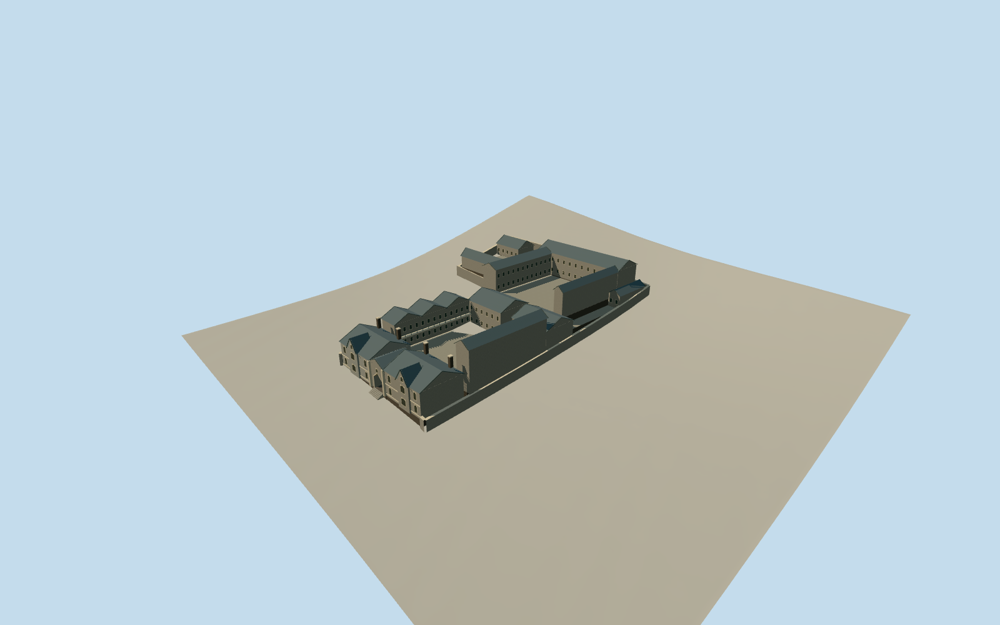

# Lyttelton Gaol

The terraced concrete Lyttelton Gaol, Oxford Street Gothic entrance and cell ranges around open yards.

Authoring state: **review-in-qa.json**. Current completion evidence is in [qa.json](qa.json) and the [completion ledger](../../../../qualla-structures/batches/qualla-003.PROGRESS.md).

- [Lyttelton Gaol](https://qualla.com/lyttelton-gaol/)

The Christchurch City Council boundary and surviving steps establish the site. The vanished building outlines, yard placements and later internal layout are estimated.

The 1878 gaoler’s yard dimensions are retained. The 1873 and 1875 records distinguish two-storey and three-storey construction. The model uses the published facts to approximate the operating complex around 1903.

Roof pitches, windows, the appearance of the gate, materials’ color and details are estimates. The reconstruction uses written evidence and mapped controls without adopting archival imagery.

The original elevation samples remain unchanged. Terraces and foundations use approximate grade registration on the steep site.

Build: `node content/worldgen/source/places/rb/rb4/lyttelton_gaol/models/generate-gaol.mjs`. Add `--check` to verify exact regeneration. 4647 triangles; 6 materials; no embedded photographs.
