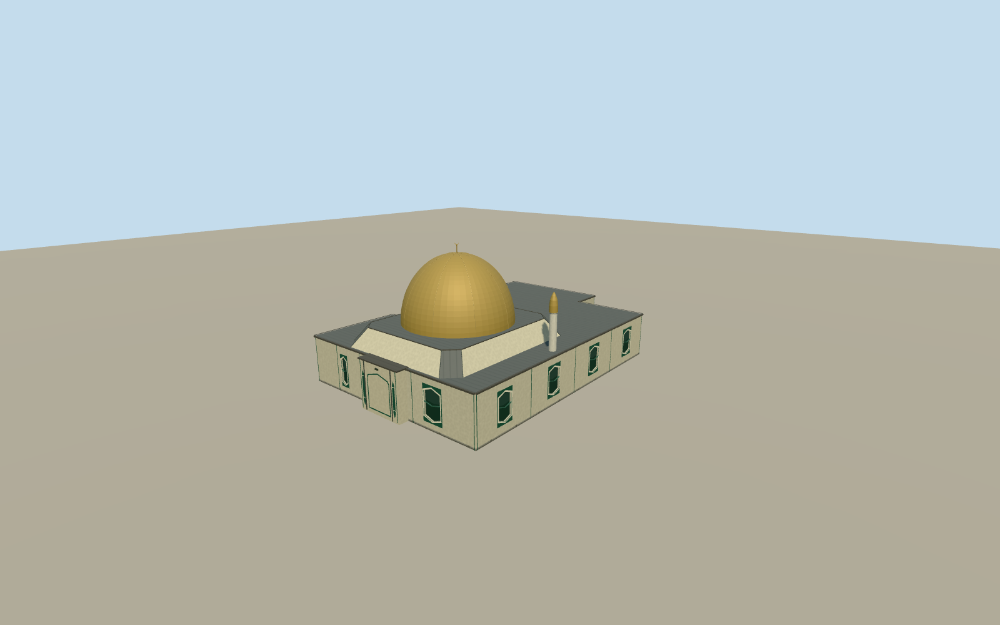

# Al Noor Mosque, Christchurch

Riccarton’s 2006 Al Noor Mosque with its low cream envelope, deep-green trim, gold dome and white-shaft minaret.

Authoring state: **review-in-qa.json**. Current completion evidence is in [qa.json](qa.json) and the [completion ledger](../../../../qualla-structures/batches/qualla-003.PROGRESS.md).

- [Al Noor Mosque, Christchurch](https://qualla.com/al-noor-mosque-christchurch/)

The exterior represents the 2006 building with dry surfaces. The photograph records temporary snow, which is outside the modeled architecture.

The broad gold dome, slim capped minaret and green panel motifs follow the dated photo. Their precise sizes, the west projection’s position, and the unpictured street and rear details are estimates.

The 2008-based footprint is the earliest available map control. The original terrain is unchanged and footing contact is approximate.

Build: `node content/worldgen/source/places/rb/rb6/al_noor_mosque_christchurch/models/generate-al-noor-mosque.mjs`. Add `--check` to verify exact regeneration. 6426 triangles; 5 materials; no embedded photographs.
