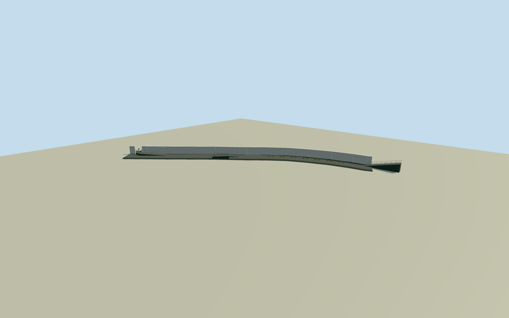

# Canterbury Earthquake National Memorial

Complete current south-bank assembly: whole110m-scale curved marble wall/nearby marble-panel divisions,7m basalt promenade/river-edge steps, native18-step west stair and rails, native eastern/intermediate ramps,seven native backless wood seats and intrinsic entrance pounamu/plinth. Exact seven mapped central marble controls retained with explicit original full-end continuation using corresponding native boundary controls; no central53m-only substitute or broad river/garden parcel extrusion. Two exact2021Embassy specificDOSpublic-domain originals, published Qualla first. Original hidden/fine section/threshold estimates explicit.

Authoring state: **review-in-qa.json**. Current completion evidence is in [qa.json](qa.json) and the [completion ledger](../../../../qualla-structures/batches/qualla-002.PROGRESS.md).

- [Canterbury Earthquake National Memorial](https://qualla.com/canterbury-earthquake-national-memorial/)

Exact namedQ28735451 central marble-wall seven-control line951820822 plus native12-control lower walkway/18-step two-control stair/five-control eastern ramp/five-control intermediate ramp. Original whole wall ends continue along corresponding southern native site-boundary controls; mapped central wall53.5m is not substituted for whole approximately111m structure. Closed review outline is an original7m physical promenade/wall strip, never the broad42-control river/garden memorial parcel.

Complete surviving south-bank memorial structure: entire approximately111m curved marble retaining/memorial wall, continuous7m basalt promenade/river-edge stepped terrace, native18-step western stair/handrail, five-control eastern accessible approach and five-control intermediate ramp, seven native backless wood seats and intrinsic entrance pounamu/plinth/water outlet. All seven actual mapped central marble-wall controls retained; full wall ends are an explicit original continuation along corresponding native memorial boundary controls, not an extrusion of the broad42-control memorial site (which includes river/north garden). North-bank planted park/trees, generic surrounding street furniture, river/water and independent bridge/buildings remain context.

Original source field frozen first. Once-only west upper-stair datum0 and18steps at estimated1/6m rise establish lower terrace floor-3m. Main wall3.6m/7m basalt promenade from builder text; eastern17m ramp rise1.1m and intermediate22.6m ramp rise1.2m are original bounded estimates of uneven street thresholds, not measured. No main floor/height/section/source fitting after authoring. Current coarse field does not resolve exact bank cuts/contact; preview/replacement false.

Whole proposed wall110.2146m versus primary110/111/112m descriptions. Actual seven central mapped marble points are exact; original full-end continuations follow corresponding native south-boundary stations without stretching controls. Site boundary is contextual evidence, not a claimed measured complete wall. Native18steps/12walkway/fiveeast/fiveintermediateramp/sevenwoodseat locations retained. Rearwall/thickness/panel arrangement/clear eastern entry opening and short end return/riveredge step section/bench dimensions/current details are bounded estimates. The inferred full-end wall is physically opened at the actual native ramp crossing, never an access-blocking solid wall.

Original517-panel source census guides a six-row division with an explicit estimated clear eastern entry opening; actual panel layout is not surveyed. Panel surfaces use original6-row division, not an exact surveyed cladding census or copied inscription. Names/fine typography/plinth motifs not replaced with invented text. Pounamu natural outline/plinth/wateroutlet and precise entry position are explicit original estimates from primary material/weight facts, not a photogrammetric sculpture. No source pixels/people/ceremony/trees/independent bridge/buildings embedded.

Original current unclassified256mfield is fixed. Terrace sits below street according to original pregeometry stair/ramp sections; footprint-owned terrain triangle openings preserve every source height. Exact host ground/threshold/contact and current repairs unverified; geographic preview/replacement false. North-bank landscaped park is context, not another fabricated building.

Build: `node content/worldgen/source/places/rb/rb6/canterbury_earthquake_national_memorial/models/generate-canterbury-earthquake-memorial.mjs`. Add `--check` to verify exact regeneration. 3880 triangles; 5 materials; no embedded photographs.
