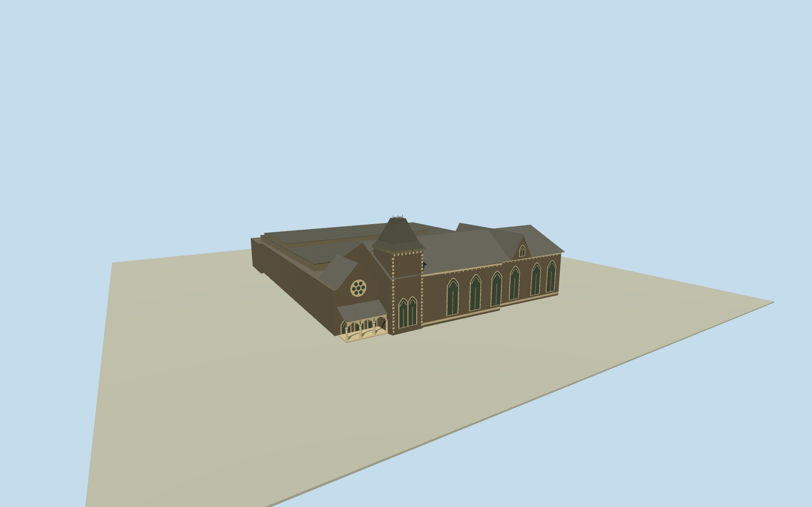

# Canterbury Museum, Christchurch

Pre-redevelopment Canterbury Museum, with a dark Gothic stone frontage, pale window tracery and a steep roof tower.

Authoring state: **review-in-qa.json**. Current completion evidence is in [qa.json](qa.json) and the [completion ledger](../../../../qualla-structures/batches/qualla-003.PROGRESS.md).

- [Canterbury Museum, Christchurch](https://qualla.com/canterbury-museum-christchurch/)

January 2016 exterior before redevelopment. Roof dimensions, concealed portions of the tower, secondary elevations and the later gallery roofs are estimates.

The temporary exhibition banner and street furnishings are outside this architectural scope.

The original elevation field is preserved. Local floor and threshold levels are representative.

Build: `node content/worldgen/source/places/rb/rb6/canterbury_museum_christchurch/models/generate-house.mjs`. Add `--check` to verify exact regeneration. 2036 triangles; 6 materials; no embedded photographs.
