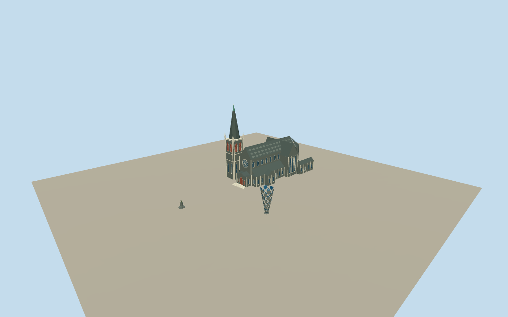

# Cathedral Square, Christchurch — intact2008 architectural ensemble

Whole intrinsic architectural ensemble in the contiguous central Cathedral Square, in its intact pre-earthquake2008phase: complete cathedral including tower/spire, nave/aisles/transepts/apse/porches/attached east annexes, the full openwork Chalice, Godley statue with complete plinth/steps and CitizensWarMemorial with cross/plinth/all six figures in their prequake native positions. All principal native exterior rings retained. Adjacent independent hotels/postoffice/library/offices, plaza parcel extrusion, temporary stalls/vehicles/trams/people, lawns/trees and interiors excluded. This is one contiguous civic architectural site, not a collection of separate city sites.

Authoring state: **review-in-qa.json**. Current completion evidence is in [qa.json](qa.json) and the [completion ledger](../../../../qualla-structures/batches/qualla-002.PROGRESS.md).

- [Cathedral Square, Christchurch](https://qualla.com/cathedral-square-christchurch/)

Original field/anchor/axes fixed before floor and main sections. Each floor samples an independent exterior approach before geometry. Council text supplies62mspire/18mChalice(2mbase,8.5mtop)/15mmemorialcross/2mGodleyfigure. Other precise vertical sections, plinth heights, roofs/hidden elevations/window census/ornament/figurative anatomy are bounded original estimates. No historic survey or exact2008grade claim. Do not fit floors, main sections or field after authoring.

Qualla-first41families/zero conflicts; two exact published ownPD structural originals remain accepted by unchanged policy. Five clear namedOwn/PD-self or selfCC0 supplements fill cathedral front/side and complete Godley/memorial form; every native revision/SHA1/size/current byte hash bound and personally inspected. No unknown-author/assumed-credit/attribution-only image adopted, no local source-rights metadata repair. Original2008cathedral pictures distinguish complete spire/rose/lancets/red belfry louvres/contrasting stone trim/patterned slate roof. Daderot full statue/plinth views and Paora restored memorial side view plus government six-figure/15m-cross facts support bounded sculptural approximations. Historic46-control cathedral wayversion5/node histories and prequake memorial8/Chalice11controls/Godley point replace current postquake geometry/relocated positions. Unphotographed back sections, precise heights/window census/roof detail, figurative anatomy/relief and grade are original estimates.

Dated2008only; no current damaged-cathedral or later relocated monument/site appearance claim. Complete ensemble geometry includes approximate sculpture anatomy/ornament and hidden cathedral roofs/elevations; source photographs never become textures. Original field/frame/floors/main sections remain fixed.

Build: `node content/worldgen/source/places/rb/rb6/cathedral_square_christchurch/models/generate-cathedral-square.mjs`. Add `--check` to verify exact regeneration. 25926 triangles; 6 materials; no embedded photographs.
