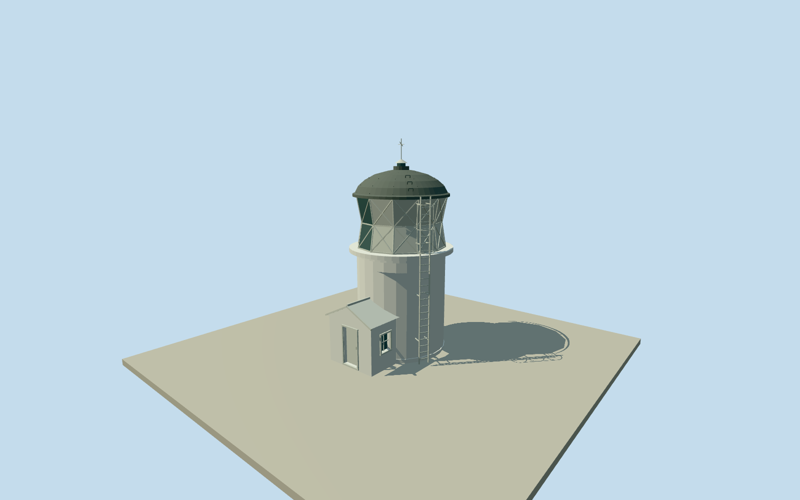

# Matiu / Somes Island Lighthouse

Complete surviving1900 white round lighthouse and native attached gabled porch. Sector lantern with landward diamond panels and seaward glass, broad gallery lip, domed metal roof/vent/access loops, tall external ladder/cage and own entry door. Full native22-vertex tower/porch boundary; no relocated1866 tower or surrounding island/site.

Authoring state: **review-in-qa.json**. Current completion evidence is in [qa.json](qa.json) and the [completion ledger](../../../../qualla-structures/batches/qualla-002.PROGRESS.md).

- [Matiu / Somes Island Lighthouse](https://qualla.com/matiu-somes-island-lighthouse/)

Complete original native lighthouse building way759327801, all22 nonduplicate outline vertices/node IDs preserved, including own attached porch corners0..3. Full vertex mean anchor[174.86374083181818,-41.25970354545455]. Original lighthouse node1052815087/Q28375022 lies[0.37390635921477655,0.15078731014888702]m from this anchor and confirms the same building, not another island tower. Own porch outer edge1to2 fixes a natural ESE entrance front; signed heading1.158762611733087rad is the exact outward normal of that mapped front edge. All arc/jog coordinates retained. Upper profiles/floors/census are photographic estimates. Native lighthouse height29 is seamark focal elevation, not building height. Fixed approach[0,6.5] before independent terrain and geometry; no surveyed threshold or host contact.

Complete surviving1900 tower and attached gabled porch only. Every native outer arc/porch point retained; a short hidden circular tower continuation is estimated beneath the porch. No relocated1866 tower, keeper cottages, island/sea/shore/vegetation/city, paths/site stairs, signs, people or interior.

One exact published2008 Matt Lamont1944x2592 public-domain original only, native SHA1/named own photographer/PD-self matched; nine source families inventoried without conflicts. Other attribution and unrelated imagery unused; no supplemental photography/copied pixels/generated bitmap. Primary DOC and harbour operator text only establish the1900 replacement and present navigation use.

Native round base/own porch positions and ESE entrance bearing retained. White plain masonry, own gabled porch/closed door/casements, broad round gallery, folded white landward lantern panels/diamond frames, muted seaward glass, domed dark metal roof/access loops/vent cowl/finial and exterior ladder/cage follow the photo. Exact9m roof/cowl proportion, lantern sector angle/pane count, concealed windows, roof/ladder/rivet census and finish after2008 are estimates. Native29m seamark height is focal elevation above sea level, never building height.

Independent64m129x129at0.5m terrain and original raw tile frozen before geometry. Fixed porch-side approach[0,6.5], provider21.9885m, full relative field[-14.763,14.8693] unchanged without clipping/fitting/flattening. Coarse composite data cannot establish building floor, threshold, steps, wall footing or precise host contact. Geographic preview; replaceFootprint=false.

Build: `node packages/worldgen/scripts/generate-authored-places.mjs --ids=matiu_somes_island_lighthouse`. Add `--check` to verify exact regeneration. 5850 triangles; 5 materials; no embedded photographs.
