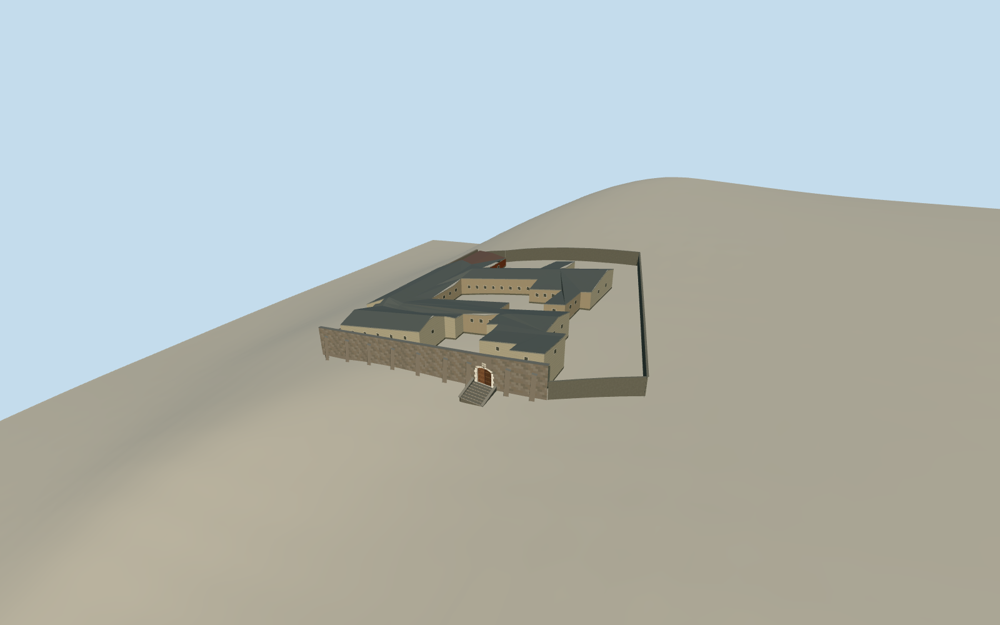

# Napier Prison

The former Napier Prison, its long rusticated sandstone wall, white-quoined stepped entrance, timber wings and enclosed yard.

Authoring state: **review-in-qa.json**. Current completion evidence is in [qa.json](qa.json) and the [completion ledger](../../../../qualla-structures/batches/qualla-003.PROGRESS.md).

- [Napier Prison](https://qualla.com/napier-prison/)

The mapped building shell and remaining enclosure are represented at medium fidelity. Roof ridge profiles, room wings, rear openings, changing wall levels, foundations and gate hardware follow the written survey and are estimated where exterior photographs provide no coverage.

The main gate follows the public-domain original. The plaque and crossed keys retain their historic position and scale, with simplified lettering and ironwork.

The source terrain is preserved. The alignment of the modeled stair threshold and courtyard floors with historic survey levels is approximate.

Build: `node content/worldgen/source/places/rb/rbv/napier_prison/models/generate-napier-prison.mjs`. Add `--check` to verify exact regeneration. 5071 triangles; 6 materials; no embedded photographs.
