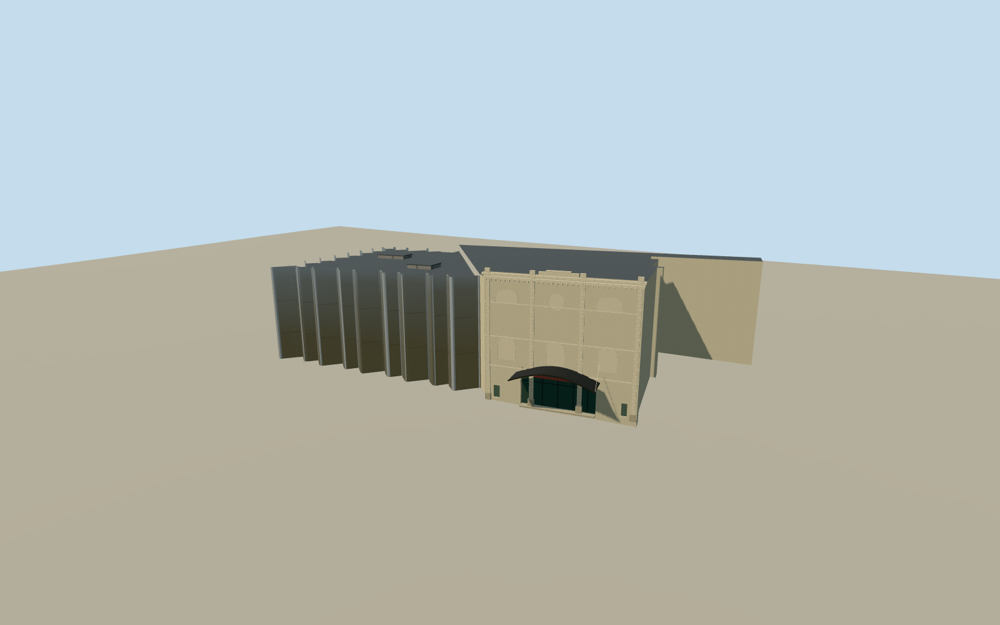

# Govett-Brewster Art Gallery and Len Lye Centre

New Plymouth’s connected galleries with a cream former-theatre frontage, suspended entrance canopy and the folded polished stainless-steel walls of the Len Lye Centre.

Authoring state: **review-in-qa.json**. Current completion evidence is in [qa.json](qa.json) and the [completion ledger](../../../../qualla-structures/batches/qualla-003.PROGRESS.md).

- [Govett-Brewster Art Gallery](https://qualla.com/govett-brewster-art-gallery/)

The model represents the connected galleries in July 2020, from the adjoining stainless-steel Len Lye Centre to the historic gallery entrance.

The named polygon provides the outline and curtain profile. The architect describes the 14 m cladded columns. The date-matched photo controls the cream facade, canopy and street finishes. Rear service details and relative roof sections are estimates.

The original Terrarium ground remains intact. Contact uses approximate paving at the Queen Street entrance.

Build: `node content/worldgen/source/places/rc/rc5/govett_brewster_art_gallery/models/generate-govett-brewster.mjs`. Add `--check` to verify exact regeneration. 3312 triangles; 6 materials; no embedded photographs.
