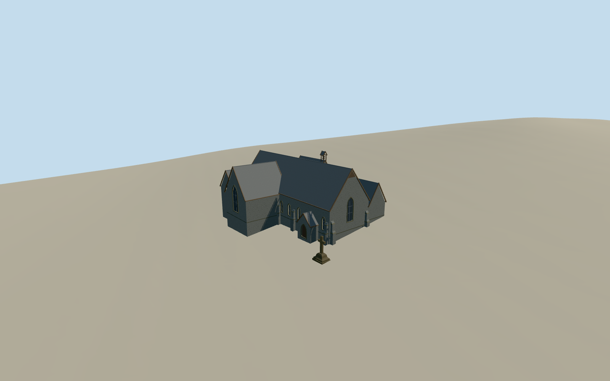

# Taranaki Cathedral Church of St Mary

Taranaki Cathedral in New Plymouth with steep slate gables, dark andesite walls, recessed Gothic lancets and the open bellcote above the attached hall.

Authoring state: **review-in-qa.json**. Current completion evidence is in [qa.json](qa.json) and the [completion ledger](../../../../qualla-structures/batches/qualla-003.PROGRESS.md).

- [Taranaki Cathedral](https://qualla.com/taranaki-cathedral/)

The exterior represents the cathedral and attached hall in July 2024. The two cleared same-day photographs control the west gable, street-side stonework, hall entrance and memorial silhouette.

The mapped 26-point envelope fixes the main exterior wall alignments. Heights, secondary roof junctions, unseen elevations and the exact position of the memorial cross are estimates. The cross inscription is simplified to the panel detail.

The original sampled Terrarium field is preserved. Local lawn, paving and foundation levels remain approximate.

Build: `node content/worldgen/source/places/rc/rc5/taranaki_cathedral/models/generate-taranaki-cathedral.mjs`. Add `--check` to verify exact regeneration. 5685 triangles; 6 materials; no embedded photographs.
