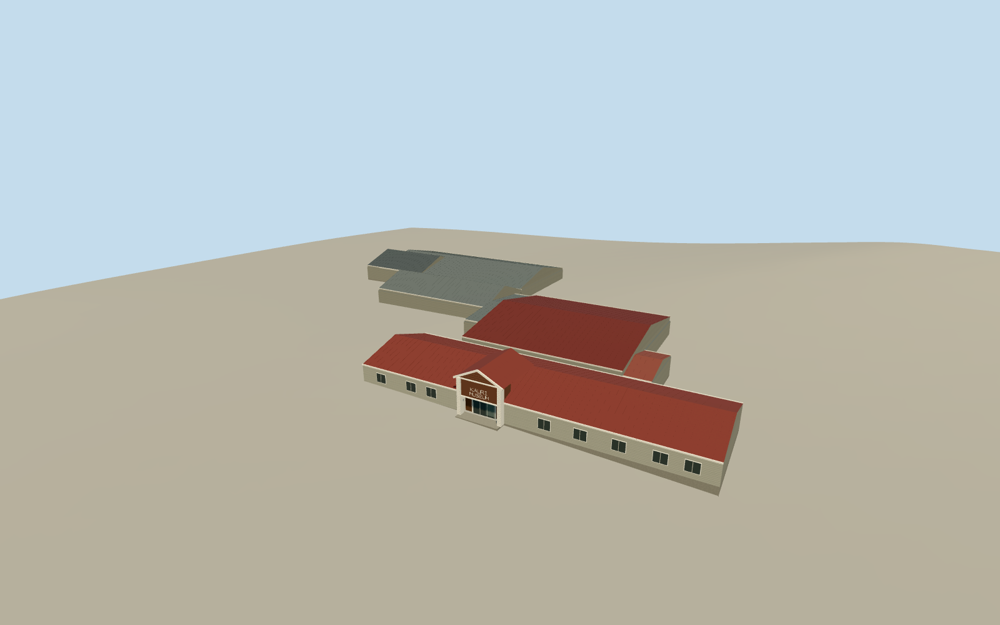

# Kauri Museum

The Kauri Museum at Matakohe has a tall cream-and-cedar gabled entrance under red metal, among connected low gallery buildings.

Authoring state: **review-in-qa.json**. Current completion evidence is in [qa.json](qa.json) and the [completion ledger](../../../../qualla-structures/batches/qualla-003.PROGRESS.md).

- [Kauri Museum](https://qualla.com/kauri-museum/)

The frontage and colour palette follow the exact 2016 public-domain image. The changed visitor route, roof sections and elevations unseen from Church Road remain approximate.

Distinct nearby school, post office and cafe buildings and the museum interior are outside the principal museum model.

Build: `node content/worldgen/source/places/rc/rce/kauri_museum/models/generate-kauri-museum.mjs`. Add `--check` to verify exact regeneration. 6784 triangles; 6 materials; no embedded photographs.
