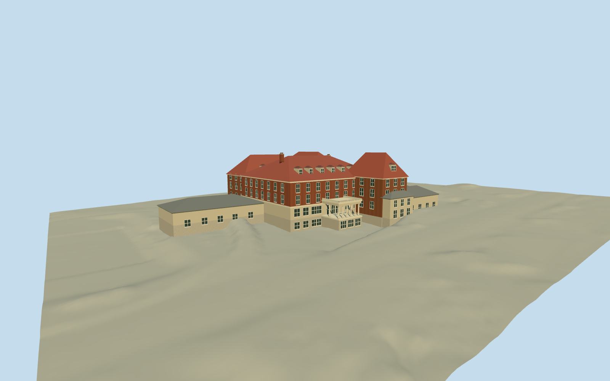

# Chateau Tongariro

Chateau Tongariro with the raised loggia and Doric portico, a red dormered roof and attached later hotel wings.

Authoring state: **review-in-qa.json**. Current completion evidence is in [qa.json](qa.json) and the [completion ledger](../../../../qualla-structures/batches/qualla-004.PROGRESS.md).

- [Chateau Tongariro](https://qualla.com/chateau-tongariro/)

The archival images show the original hotel. Modern wing detail, infill and rear service entrances are inferred from the footprint and numeric roof surveys.

Roof finish, trim colors, parapet detailing and small rear openings are estimates.

Build: `node content/worldgen/source/places/rc/rch/chateau_tongariro/models/generate-chateau-tongariro.mjs`. Add `--check` to verify exact regeneration. 12022 triangles; 6 materials; no embedded photographs.
