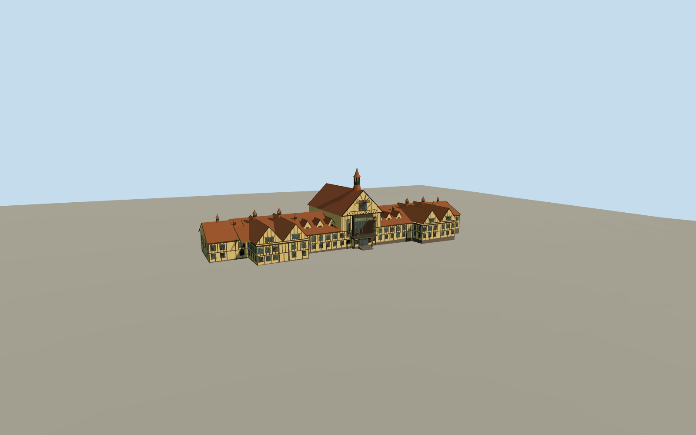

# Rotorua Museum

The former Rotorua Bath House after the Centennial extensions, with a broad west-facing half-timbered facade, glazed central entrance bay, paired north and south gables, and terracotta ridge lanterns.

Authoring state: **review-in-qa.json**. Current completion evidence is in [qa.json](qa.json) and the [completion ledger](../../../../qualla-structures/batches/qualla-003.PROGRESS.md).

- [Rotorua Museum](https://qualla.com/rotorua-museum/)

The named OpenStreetMap outline controls the exterior footprint. The January 2016 photographs document the west appearance after the 2008 and 2011 wing extensions.

Roof junctions behind the main facade, window spacing on the rear and end elevations, and architectural heights are estimated.

The independent elevation source is preserved. Foundations and stairs reflect an approximate local threshold.

The model represents the Bath House building and its attached wings. The rest of Government Gardens, collection interiors and post-2016 restoration work are outside the historical view.

Build: `node content/worldgen/source/places/rc/rcj/rotorua_museum/models/generate-rotorua-museum.mjs`. Add `--check` to verify exact regeneration. 8030 triangles; 5 materials; no embedded photographs.
