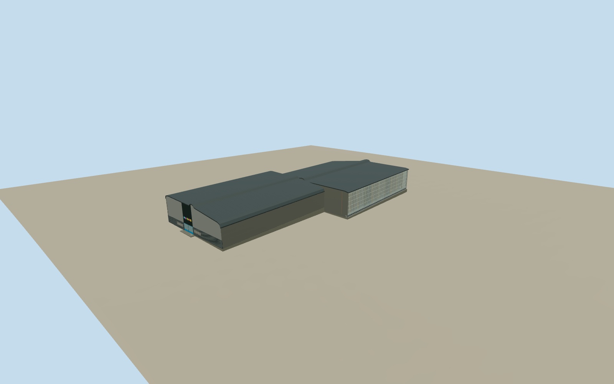

# MOTAT Aviation Hall

The north gallery is a glazed heat chimney under a deep, asymmetric aircraft-wing roof. The architect confirms a 42 m unsupported timber span, and the structural supplier documents a 28 m by 9 m hangar opening. The public entrance was upgraded in 2022. The exact photos establish the folded elevations, ventilation bands and glazed door treatment.

Authoring state: **review-in-qa.json**. Current completion evidence is in [qa.json](qa.json) and the [completion ledger](../../../../qualla-structures/batches/qualla-003.PROGRESS.md).

- [Museum of Transport and Technology](https://qualla.com/museum-of-transport-and-technology/)

The mapped roof envelope controls the exterior footprint. Curvature, folded profile, side doors and plant are based on the limited views and architectural records. The floor at the two linked volumes is an estimate.

Original DEM elevations provide the context. Local ground contact and the unpictured service façades are approximate.

Build: `node content/worldgen/source/places/rc/rck/motat_aviation_hall_auckland/models/generate-motat-aviation-hall-auckland.mjs`. Add `--check` to verify exact regeneration. 1906 triangles; 5 materials; no embedded photographs.
