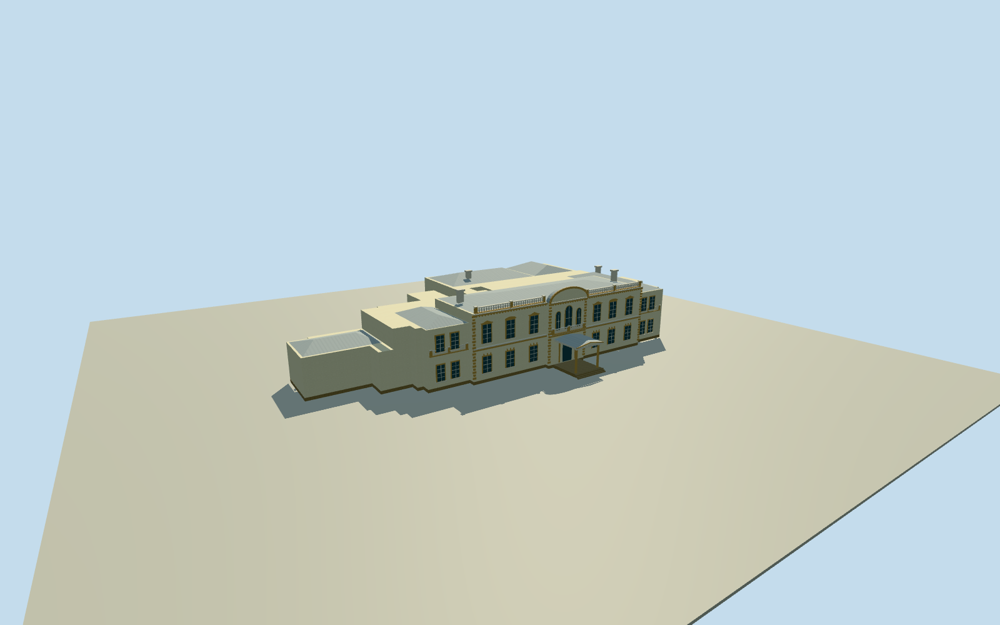

# Old Government House, Auckland

Cream and ochre Old Government House with a curved pediment, balustrades, hipped wings and a northeast entrance portico.

Authoring state: **review-in-qa.json**. Current completion evidence is in [qa.json](qa.json) and the [completion ledger](../../../../qualla-structures/batches/qualla-003.PROGRESS.md).

- [Old Government House, Auckland](https://qualla.com/old-government-house-auckland/)

The 42-corner outer outline, 15-corner open court, attached northeast portico and rear covered passage come from mapped building and roof records. The central roof, wing roof slopes and concealed rear details are visual estimates.

One inspected 2008 public-domain photograph establishes the cream and ochre lawn facade, three arched upper sashes, segmental pediment, roof balustrade, stepped entry, roof stacks and hipped wings. The neighboring Gothic clock tower belongs to a separate building.

Vertical dimensions, secondary window positions, roof geometry and local grade are approximate. The 128 m original terrain field was frozen before the floor and sections. Model represents a dated 2008 interpretation.

Build: `node content/worldgen/source/places/rc/rck/old_government_house_auckland/models/generate-house.mjs`. Add `--check` to verify exact regeneration. 9612 triangles; 6 materials; no embedded photographs.
