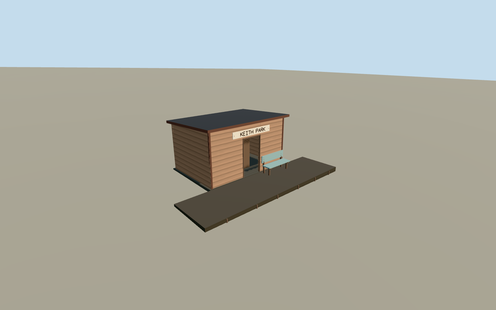

# Sir Keith Park Station

The public-domain Qualla original shows pale pink weatherboard siding, a dark open doorway, a brown flat-looking fascia, an off-white station board and a pale green bench. Dimensions of the roof, bench and openings are inferred from the photo and plan.

Authoring state: **review-in-qa.json**. Current completion evidence is in [qa.json](qa.json) and the [completion ledger](../../../../qualla-structures/batches/qualla-003.PROGRESS.md).

- [Museum of Transport and Technology](https://qualla.com/museum-of-transport-and-technology/)

The station enclosure footprint comes from the current mapped polygon. The rear wall, threshold, exterior bench and roof slope are reconstructed from a single front view.

The unmodified terrain field provides approximate vertical placement at the threshold. The model includes the shelter and immediate apron.

Build: `node content/worldgen/source/places/rc/rck/sir_keith_park_station_auckland/models/generate-sir-keith-park-station-auckland.mjs`. Add `--check` to verify exact regeneration. 512 triangles; 4 materials; no embedded photographs.
