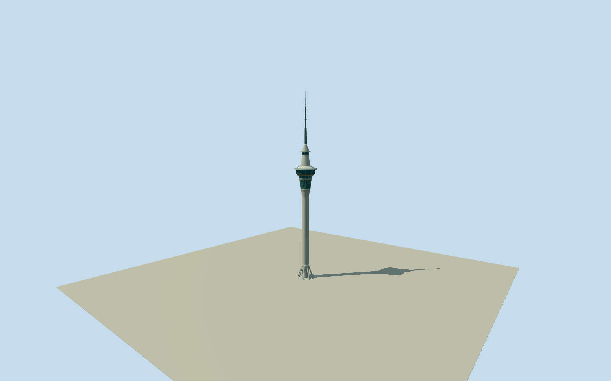

# Sky Tower (Auckland)

Whole328mAuckland Sky Tower:12mconcrete shaft/eight open raked base legs and collar, recessed lift slots, precast flare fins, layered bluegreen-glazed main pod with aluminium rings/mullions/radial supports and open outer ledge, separate small220mSkydeck and complete stepped telecommunications antenna. Exact published2023creatorCC0original, native whole envelope/named upper bands and primary engineer/architect/operator text. Intermediate sections and hidden base interfaces estimated; no neighboring SkyCity buildings/site slab.

Authoring state: **review-in-qa.json**. Current completion evidence is in [qa.json](qa.json) and the [completion ledger](../../../../qualla-structures/batches/qualla-002.PROGRESS.md).

- [Sky Tower](https://qualla.com/sky-tower-auckland/)

Original named Sky Tower building relation9692605/Q722125 retains complete component geometry and original outline697464067. Anchor is original32-vertex Skydeck1173272340circle vertex-mean, not the coarse story point. Whole outline is maximum building extent, not a ground-level parcel or footprint to extrude through the tower. Named native SkyBar329588157has179–183mlevels, Orbit697464068has187–194mlevels, and Skydeck1173272340has220–224mlevels. Other member outlines have no saved vertical attributes, so unlabelled member identities/heights are NOT invented. Twelve-metre shaft/eight raked base legs come from primary engineering text;328mheight and186/192/220mpublic levels from architect/operator text. Intermediate collars/flared neck/roof ledges/mast sections and hidden base interfaces are explicit photo/engineering interpretations, not measured floor surveys. Model+Xeast,+Zsouth, heading0; exact slit/base-door angular census is approximate. Fixed eastern approach[26,0]chosen before terrain/geometry. No neighboring casino/hotels/theatre, whole plaza or site pad.

Exact already-published5152x3864AugustDominus2023QuallaCC0original inspected/native SHA17f8f098af469e946cd7940f56468736007f16582matched to pinned own-work/selfCC0release. Full31source families inventoried without conflict. All other attribution/interior/panorama images unused. Primary professional engineer/architect/operator facts used as text only; no new photo/diagram/copied pixels/generated bitmap.

Original named tower relation9692605/Q722125/62point whole maximum outline and original named SkyBar179–183m/Orbit187–194m/Skydeck220–224mrings retained in source controls. Whole outer envelope is not a40mwide ground shaft or site pad. Native Skydeck32point mean anchors toweraxis; heading0. Twelve-metre shaft/eight raked base legs and328mheight are primary-text controlled. Intermediate shoulders, ledges, leg/fin dimensions, main glass subdivisions, shaft/entry slit bearings, antenna sections and hidden current ground interfaces are bounded photo/engineering estimates. Temporary lighting/signage/neighbors/whole plaza/interiors absent.

Independent192m129x129at1.5m terrain from16641samples/one original Terrarium tile, frozen before geometry. Fixed eastern approach[26,0]; provider26.6608m/whole relative[-4.1585,5.6263]m. Raw tile/grid/PNG unchanged without clipping/fitting/flattening.3.8229moutput pixel spacing oversamples coarser urban composite DEM, possibly roofs/vegetation; exact base/core/leg foot/plaza/host contact unverified. Geographic preview, replaceFootprint=false.

Build: `node packages/worldgen/scripts/generate-authored-places.mjs --ids=sky_tower_auckland`. Add `--check` to verify exact regeneration. 22584 triangles; 4 materials; no embedded photographs.
