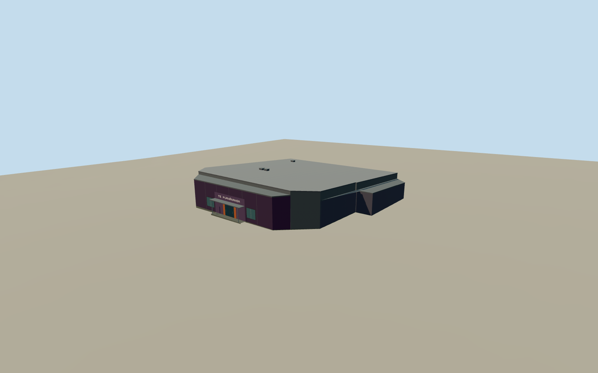

# Te Puawānanga Science and Technology Centre

C3 Construction repaired and over-roofed the historic warehouse in 2023. MOTAT opened the reworked exhibition hall in 2024. The height profile follows current numerical measurements, with estimated exterior openings.

Authoring state: **review-in-qa.json**. Current completion evidence is in [qa.json](qa.json) and the [completion ledger](../../../../qualla-structures/batches/qualla-003.PROGRESS.md).

- [Museum of Transport and Technology](https://qualla.com/museum-of-transport-and-technology/)

The mapped footprint and sampled 2024 bare-ground and roof elevations constrain the overall profile. The location of the entrance, spacing of wall openings, southern threshold details and finish distribution are approximate.

The model uses the original Terrarium review terrain. The independent LINZ numbers constrain the roof skin and grade rise.

Build: `node content/worldgen/source/places/rc/rck/te_puawananga_auckland/models/generate-te-puawananga-auckland.mjs`. Add `--check` to verify exact regeneration. 741 triangles; 5 materials; no embedded photographs.
